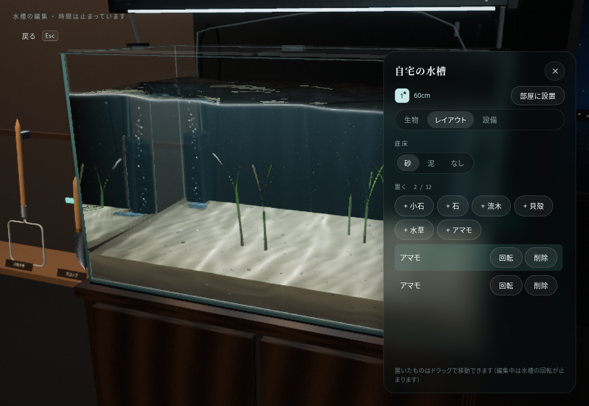
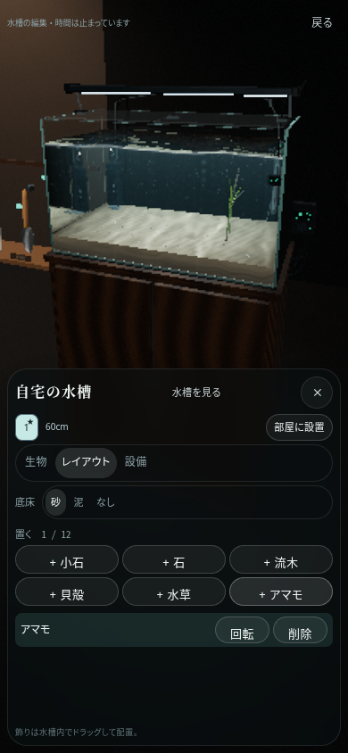

# 水槽のアマモ

「水槽 → レイアウト → ＋アマモ」で配置します。既存の「水草」とは別のインテリアです。ドラッグで移動、一覧から回転・削除ができ、配置は各水槽のセーブに保存します。

既存の `src/world/amamo/AmamoPatch.ts` / `AmamoKit` の株・葉・シェーダーを再利用しています。水槽用には小さな若い株のまとまりとして配置し、根茎は底床の中に埋めます。ホームでは水流に応じて揺れ、編集中は静止します。水位は水槽の高さと部屋内のオフセットを含めて渡すため、45cm水槽や別水槽へ切り替えても葉先は水面に沿います。

同じ水槽の株はマテリアル・基本頂点バッファを共有。画質・視距離に合わせて既存モデルのLODを使い、超軽量でもアマモを表示します。株を削除する際はその株のインスタンスだけを解放し、共通リソースは最後の株を取り除いたときに解放します。

スマホでは底床ラベルと選択肢を同じ行に配置し、追加・回転・削除ボタンもコンパクトにしています。

検証: `npm run check`、`npm run build`、`npm run smoke:amamo`。アマモの追加・実際のポインタードラッグ・回転・削除、45/60cmの複数水槽、保存・再読み込み、4画質、共有リソースの寿命、スマホ縦横4サイズを確認します。
