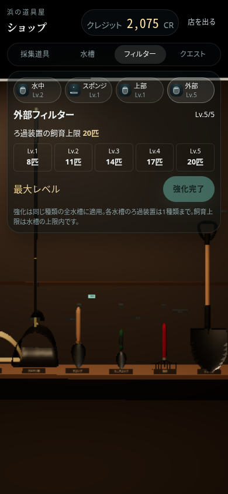
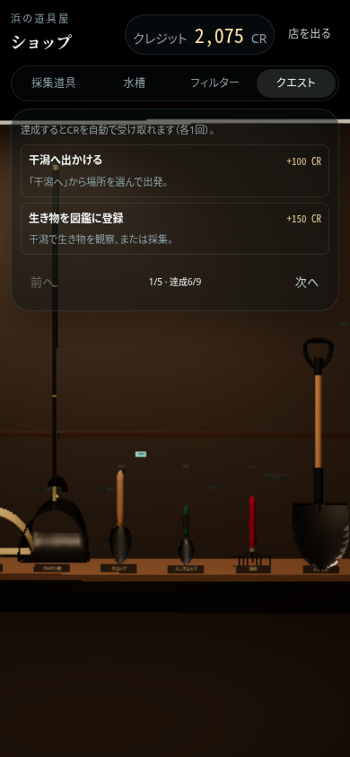

# 水槽・ろ過装置のショップと導入クエスト

ホームの「ショップ」に、水槽・フィルター・クエストの売り場を追加。水槽編集の「ろ過装置を強化」、設備詳細の「解放・強化」、部屋の設置画面からもショップへ移動できます。

60cm水槽＋標準台と水中フィルターLv.1は無料で、初期の飼育上限は4匹です。別サイズと別種類のフィルターはCRで解放します。解放とフィルターレベルは全水槽で共有され、ガチャは仕上げのデザインを獲得するものです。ガチャで未解放種類のデザインを獲得しても、ショップでの解放が必要です。

| 水槽＋標準台 | 解放価格 | 水槽による飼育上限 |
| --- | ---: | ---: |
| 45cm | 150 CR | 6匹 |
| 60cm | 無料 | 10匹 |
| 90cm | 450 CR | 16匹 |
| 120cm | 900 CR | 20匹 |

| ろ過装置 | 解放価格 | Lv.1 → Lv.5の飼育能力 | Lv.2 / 3 / 4 / 5への強化費 |
| --- | ---: | --- | --- |
| 水中フィルター | 無料 | 4 / 5 / 6 / 7 / 8匹 | 50 / 100 / 150 / 200 CR |
| スポンジフィルター | 150 CR | 5 / 6 / 7 / 8 / 9匹 | 75 / 125 / 175 / 225 CR |
| 上部フィルター | 300 CR | 6 / 8 / 10 / 12 / 14匹 | 100 / 150 / 225 / 300 CR |
| 外部フィルター | 500 CR | 8 / 11 / 14 / 17 / 20匹 | 150 / 225 / 300 / 450 CR |

実際の上限は「水槽による上限」と「装備したろ過装置の能力」の小さい方です。各水槽で同時に使えるろ過装置は1種類。同じ種類を複数置いても能力は加算せず、色によって能力は変わりません。別種類を設置すると既存のろ過装置と交換し、ホース・電源・エア用品はプリセットで接続します。クーラーは外部フィルターを自動追加せず、必要に応じて循環ポンプを付属します。

上限を超える交換・水槽の縮小は拒否し、生き物は自動削除しません。先にケースへ移してください。既存セーブで使用中のサイズ・フィルターと獲得済みデザインは移行時に維持し、使用中の複数種類は能力の高い1種類に整理します。保存・読み込みと3D表示も最大20匹に対応しています。

ホーム端の「手引き・クエスト」とショップの「クエスト」で9件の導入クエストを確認できます。達成時に自動でCRを付与し、受取済み記録は保存・再読み込みしても維持します。

| クエスト | 報酬 |
| --- | ---: |
| 干潟へ出かける | 100 CR |
| 生き物を図鑑に登録 | 150 CR |
| 初めての採集 | 150 CR |
| 水槽に生き物を入れる | 150 CR |
| ろ過装置を強化する | 100 CR |
| 新しいフィルターを解放 | 150 CR |
| 新しいサイズの水槽を解放 | 150 CR |
| 部屋に2台の水槽を設置 | 150 CR |
| 生き物の行動を記録 | 100 CR |
| **合計** | **1,200 CR** |

スマホでは売り場と設備種類を切り替え、詳細を1件ずつ表示します。クエストは2件ずつ、生物一覧は6匹ずつのページ切り替え。20匹を飼育していても、縦横画面ともボタンをスクロールせず操作できます。フィルターの強化ボタンは編集タブと同じ行に配置します。

検証: `npm run check`、`npm run build`、`npm run smoke:progression`、`npm run smoke:room`、`npm run smoke:recovery`、`node tests/smoke/mobile.mjs --editor-lite`。ブラウザ検証はCR不足・重複購入・強化上限・ガチャチケット不変・重複投入・20匹の表示と保存・上限を超える交換拒否・複数水槽の共有レベル・実際の干潟入場による一度だけの報酬・スマホ4画面サイズのショップ／生物一覧／設備編集を確認します。
