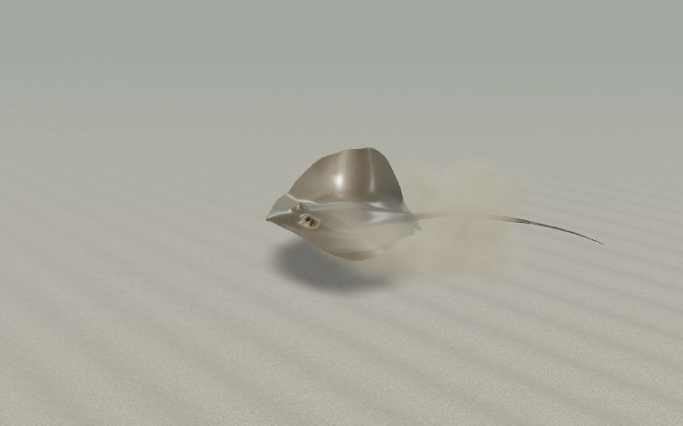
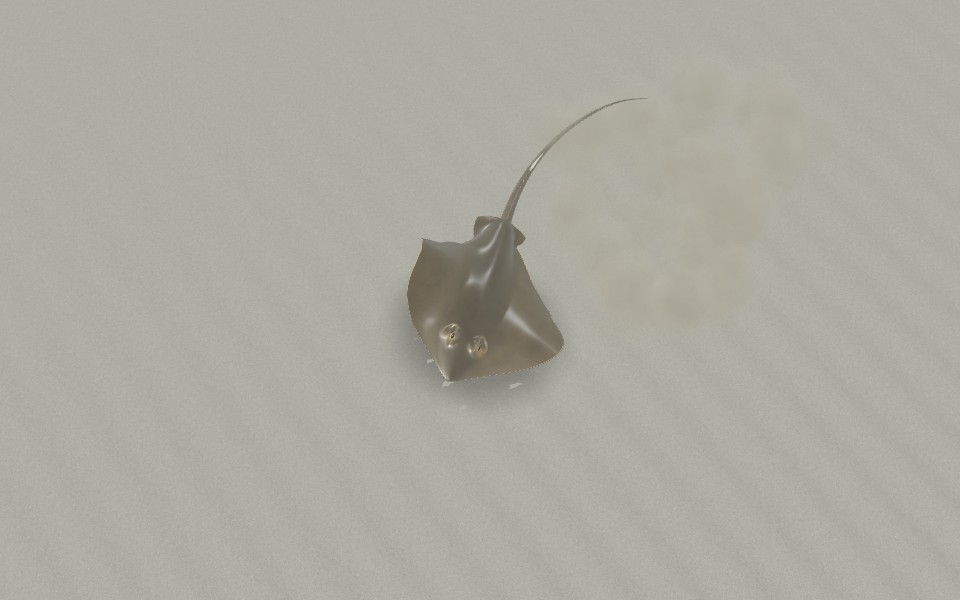
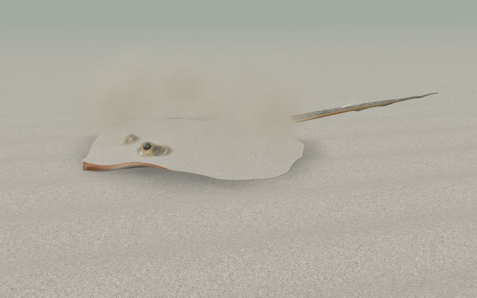
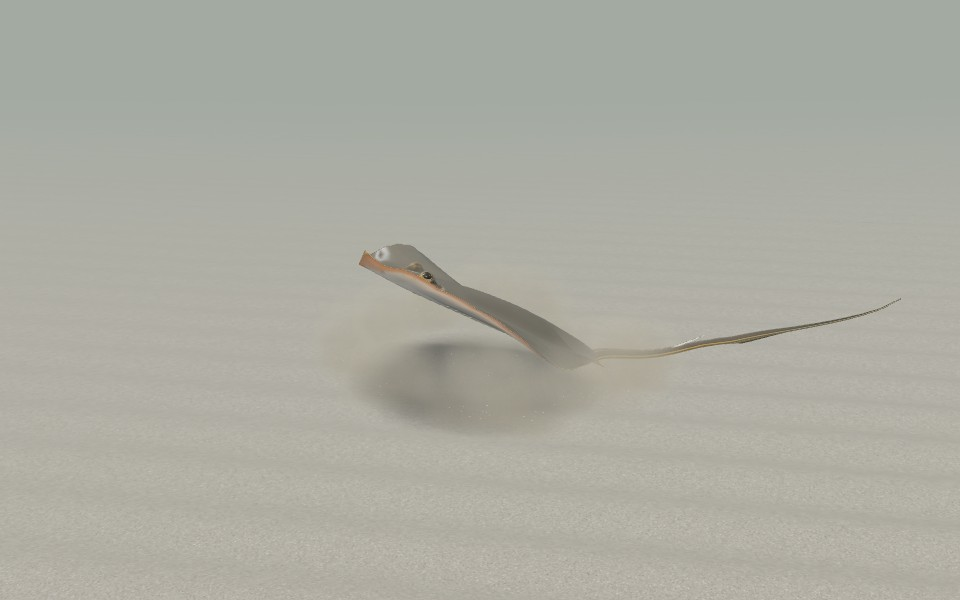
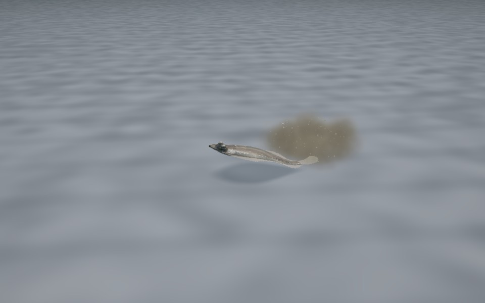
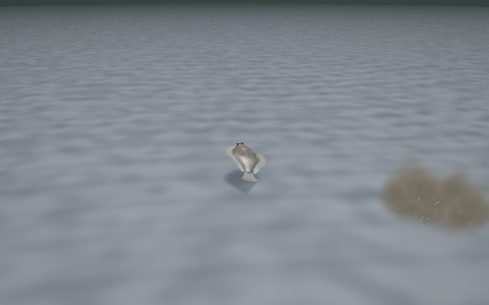
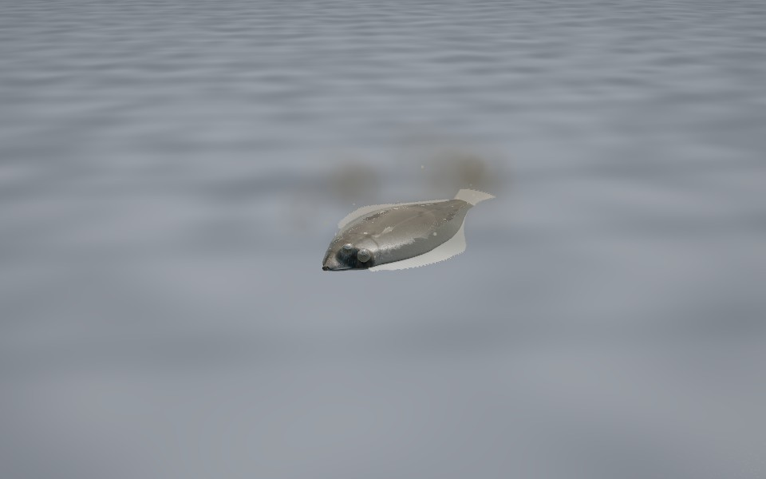
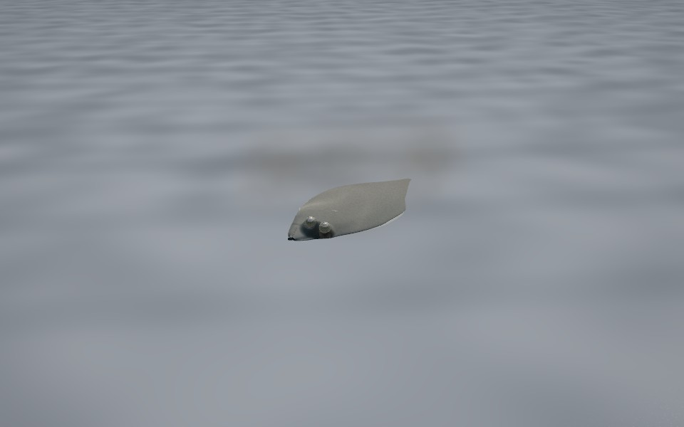
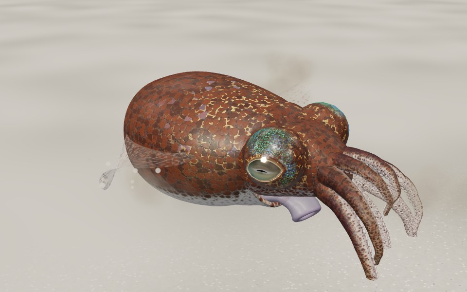

# 砂煙（魚やエイが舞い上げる砂）

底にいる魚やエイが動くと、砂や泥が水に舞い上がる。その砂煙を、全種で共有する 1 つの層で描く。コードは `src/creatures/fx/SandDust.ts`。

いま使っている種:

- アカエイ
- イシガレイ
- ミミイカ

|  アカエイ: 潜っていたところから逃げる |  同じ逃避を上から（体盤の下と縁から） |
|---|---|
|  アカエイ: 砂潜りのはためき |  アカエイ: 底を離れる |
|  イシガレイ: 潜った姿から飛び出す |  残った雲がゆっくり沈む |
|  イシガレイ: 潜砂（砂粒が背にかかる） |  潜り終えたところ（雲は沈んで薄れる） |
|  ミミイカ: 漏斗で砂を吹いて潜る | |

## 1. 何が舞うか

粒子は 3 種類。

| 種類 | 見え方 | 動き |
|---|---|---|
| 泥の雲（シルト） | ふわっとした雲。縁がもくもくと崩れる | 投げ上げられても水の抵抗ですぐ止まる。膨らみながらゆっくり沈む。うねりや寄せ波で前後に揺れる（`physics/water.ts` の `WaterMotion`） |
| 砂粒 | 小さな粒。近くで見たときだけ見える | 飛び出して 1 秒ほどで落ちる。底に着くと止まり、すぐ見えなくなる |
| 墨（ミミイカ） | 暗い雲 | ほとんど沈まずに漂う |

- **底質で変わる**: 足元の底質（`HabitatSample.substrate`）で色と量が変わる。
  - 泥の上: 雲が多く、大きく、長く残る。砂粒は少ない。
  - きれいな砂の上: 砂粒が多く、雲はすぐ沈む。
- **色**: 雲は底の砂より少し暗く、少し茶色い（細かい泥や有機物の色）。
  - 底の上では濁ったベールに見える。
  - 水の奥を背にすると明るいもやに見える。

## 2. 描きかた

- **描画の数**: 生きものがいるグループ（干潟の `creatures`、水槽、観察ケース）ごとに 1 つの層（`sandDustFor(parent)`）。何匹いても 1 回の描画（点スプライト、最大 2048 粒）。
- **光**: シーンのライトで照らす。
  - 雲の上側は明るく、濃い芯は自分の陰で少し暗い。
  - 太陽の方を向いて見ると、薄い縁が光る（前方散乱）。
- **底との境目**: 板（スプライト）が底と交わるところでは雲を薄くして消す。底に切られた硬い線を出さない。
- **近すぎるとき**: 目が雲の中に入ると透かす。GPU が描ける点の大きさを超える雲は、縮めずに薄くする。
- **水と霧**: ゲームの水のパスは、底と同じように雲も屈折させ、色を付ける。シーンの霧（ビューア）にも従う。

## 3. 時間と更新

- **時間**: 生きもののシミュレーションの時間で進む。観察のスロー再生（0.25×など）では砂煙も遅くなる。
- **誰が進めるか**: 近くにいる個体のどれか 1 匹が、1 フレームに 1 回進める。
  - 2 フレームや 4 フレームおきに更新される遠い個体より、毎フレーム更新される個体が優先。
  - 進める個体がいなくなったら、画面の時計で進む。
- **重さ**: 生きている粒だけを動かし、GPU に送る。
  - 底の高さ: 砂粒は毎フレーム、雲はときどき（底に近いときは毎回）調べる。
  - 水の流れ: 1 粒あたり 8 フレームに 1 回調べる。

## 4. 出さないとき

- **砂がない場所**: 観察ケース、底砂のない水槽（`DriverContext.canBurrow === false`）。
- **遠い個体**: 見えないので出さない。
  - アカエイ: 22 m まで（LOD1 まで）。
  - イシガレイ: 3 m まで（近い個体）。水槽と観察中はいつも出す。
  - ミミイカ: LOD2 のときは出さない。
- **画質**（`QualityPreset.sandDust`、出す粒の割合）:

| 画質 | 割合 |
|---|---|
| 超軽量 | 0（出さない。接地影と同じ） |
| 低 | 0.5 |
| 中・高 | 1 |

## 5. 種ごとの出しかた

| 種 | いつ | 何を |
|---|---|---|
| アカエイ（`AkaeiDriver.ts`） | 底を離れる・降りる | 体盤の縁の周りから外へ、輪のように雲と砂粒 |
| | 砂に潜る | はためくたびに、縁の下から背中へ（砂粒が背に降る） |
| | 餌を掘る | 押しつけるたびに口の下から雲。鰓孔から左右へ細かい泥 |
| | 逃げる（潜っていたところから） | 縁と体盤の下全体から大きな雲 |
| | 泳ぎ出す | 背に積もっていた砂が粒になって滑り落ちる |
| | 底すれすれを泳ぐ・強く打つ | 後ろの縁の下から巻き上がり続ける（低いほど、強く打つほど多い） |
| イシガレイ（`IshigareiDriver.ts`） | 離底・潜砂・逃避・着底・ついばみ・鰓からの砂の吐き出し | 行動（`behavior.js`）の `world.silt`（泥の雲）と `spray`（砂粒）を、そのまま位置・速さ・量で受ける |
| | 底すれすれで尾を強く打つ・背鰭と臀鰭を波打たせる | 尾の後ろ、体の縁の下から巻き上がる |
| ミミイカ（`MimiikaDriver.ts`） | 行動（`behavior.ts`）の `fx` | 砂は泥の雲と砂粒、墨は漂う雲 |

## 6. 新しい種に付ける

ドライバに次を足す。

```ts
import { keepSandDust, sandDustFor, type DustSource } from '../../fx/SandDust';

// attach: 生きもののいるグループの層から、その個体用の口をもらう
this.dust = sandDustFor(root.parent ?? root).source(() => rng.next());

// update: 近いときだけ。層を進め、足元の底質を教える
this.dust.near = level <= 1 || locked;
if (this.dust.near) this.dust.tick(dt, ctx);
this.dust.setBed(ctx.floor.sampleAt?.(x, z)?.substrate);

// 行動の中で
this.dust.kick(at, vel, count, spread, size);       // 泥の雲と、それより強く飛ぶ砂粒
this.dust.silt(at, vel, count, spread, size);       // 泥の雲だけ
this.dust.grains(at, vel, count, spread);           // 砂粒だけ
this.dust.stream(dt, perSecond, at, vel, spread, size); // 続けて巻き上げる

// detach
this.dust.release();
```

- 数（`count`）は画質の割合で間引かれる。
- 大きさ（`size`）は雲の最初の直径（m）。雲は寿命のあいだに 2.6〜3.2 倍に膨らむ。
- シェーダは、保持用モデル（`DriverEntry.keep`）に `keepSandDust(parent)` を足すと読み込み中にコンパイルされる。

## 7. 確かめる

- 単体テスト `tests/unit/sandDust.test.ts`:
  - 雲は上がって止まり、沈む。砂粒は落ちる。底より下に行かない。
  - 泥の上は長く残る。うねりで揺れる。
  - 1 フレームに 1 回だけ進む。
  - 砂のない場所、遠い個体、画質で出さない・間引く。
  - 粒の上限。
- 保持用モデルが砂煙のシェーダを持つこと: `tests/unit/keptShaders.test.ts`
- この文書の画像: `npm run render:sand-dust`（3 種のビューアを順に撮る。撮る場面は `tools/models/akaei/dust-shots.mjs`、`tools/models/ishigarei/dust-shots.json`、`tools/models/mimiika/dust-shots.json`）

## 8. 限界

- 雲は板を重ねたもの。体積として影を落としたり、底を暗くしたりはしない。
- 底の砂は動かない。舞い上がった砂が積もって地形が変わることはない。掘り跡はアカエイの `SandFX`（接地影と掘り跡）だけ。
- 水槽のろ過装置が作る流れには乗らない（干潟のうねりと寄せ波だけ）。
