# 葛西 東なぎさ — 石積みの堤に囲まれた干潟

葛西のマップ（地図 ID は互換のため `kasai_west` のまま）を、西なぎさの開けた浜から**東なぎさ型**に作り直しました。外周は U 字の捨石の堤で、南の口元から海に開きます。堤の内側はランダムな起伏の干潟で、引き潮のあとに潮だまりがあちこちに残ります。堤ぎわの砂の高みには、季節で色の変わるヨシが少しだけ生えます。形は参考画像（ミニマップのイメージ）と、写真資料の航空写真（過去の東なぎさ・造成途中）に合わせました。色は写真資料 35 枚から測っています。実在地の再現ではありません。実際の東なぎさは立入禁止の保護区ですが、ゲームでは歩けます。

- 地形の作り直し: `node tools/terrain/bake-map.mjs`（`public/data/maps/kasai_west/height.png`・`substrate.png`）
- 見た目の確認: `npm run build` のあと `node tests/smoke/kasai-east.mjs [--month 7] [--tide -0.6]`（`tests/smoke/out/kasai-m<月>-*.png`）

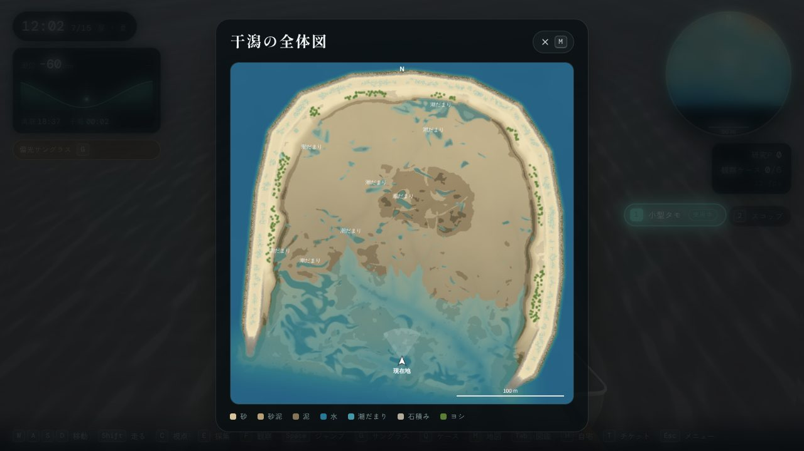

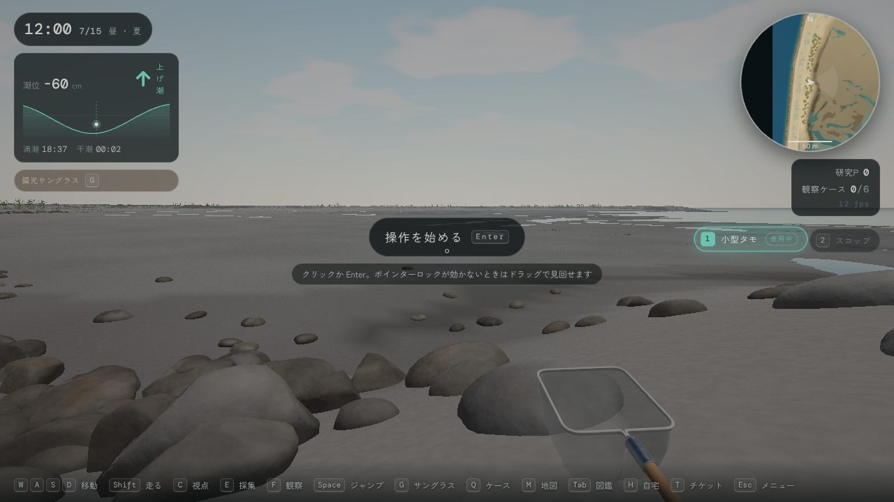

## 1. 形

| 部分 | 作り |
|---|---|
| 範囲 | 320 m × 320 m、北が上（x 東、z 南） |
| 堤 | 中心線は地図データ `levee.path`（西の先端 → 北 → 東の先端）。天端は T.P. +2.8 m 前後、天端の半幅 3 m、法面は勾配 1:2 の平らな面（表面の凹凸はつけない）。両端から 28 m で沈み、先端は海中の捨石の山になる |
| 堤の外 | 水深 2 m 余りの海（T.P. −2.4 m）。口元の前だけ、干潟の砂が出て浅い |
| 干潟 | 口元（T.P. −1.0 m）から奥の北へ緩く上がる（奥で +0.4 m 前後） |
| バーム | 堤の内側の足元にある、満潮線より高い砂の高み（T.P. +1.45 m 前後、幅 7〜16 m）。北側ほど広く、先端に向かって細る。ヨシと漂着帯はここにある |
| 起伏 | 島のような砂州は置かない。ランダムなノイズで数十 cm の起伏をつける。くぼみは等高線に沿って（東西に）少し長く伸び、低い高まりの背後で水を溜める（実際の干潟の尾根とランネルのように）。形は不規則で互いにつながり、底は平ら。大小が混じり、集まる場所とまばらな場所がある。干潮（T.P. −0.7 m）でも 60 か所以上のくぼみに水が残る |
| 澪 | 深さ 10〜30 cm の浅い溝。口元から入り、中央を蛇行して北へ枝分かれする。底質は周りと同じで、地図に線は描かない |
| 泥干潟 | 中央の奥の静かな場所。参考画像で中央にあった緑の小島の位置。植物は置かない |
| スタート地点 | 西の堤ぎわのバームの上（東を向いて干潟を見渡す） |

## 2. 色（写真から測った値）

写真資料の画像を切り出し、領域ごとの平均色を測りました。3D の地面は**写真の色**に、ミニマップと全体図は**読みやすさを優先した明るい色**（参考画像のような航空写真の色）にしています。

| 対象 | 写真の平均（sRGB） | ゲームでの扱い |
|---|---|---|
| 乾いた砂（p.15・26） | 139,130,120／125,119,108（比 1 : 0.94 : 0.85） | 葛西だけ砂の色に補正（1.36, 1.18, 0.92）をかける（明るく暖かく）。走水・漫湖の砂は変えない。ゲーム内は 121,115,106（比 1 : 0.956 : 0.878） |
| 濡れた干潟（p.7・35） | 116,118,114／111,111,113（ほぼ無彩色） | 直前の満潮線より下は一面に濡れたまま（上の方ほど少し乾く）。濡れると 0.76 倍に暗く、青みのある無彩色に寄り、つやが出る。ゲーム内は 102,100,95 前後（比 1 : 0.98 : 0.94） |
| 泥・砂紋（p.6・16） | 66,59,64／87,78,83（暗い紫がかった灰褐色） | 泥の地色のまま。夏は珪藻の金茶色の膜が出る |
| 堤の石・乾いた上部（p.25・35） | 108,103,96／137,122,105 | 淡いベージュ（T.P. +1.1〜1.7 m より上） |
| 堤の石・藻の帯（p.20） | 54,62,47 | 緑の藻（T.P. +0.15〜+1.3 m、斑状） |
| 堤の石・カキの帯（p.34） | — | T.P. 0 m より下は暗いカキ殻の色。この帯にマガキの株が付く |
| 水（p.8・26・27） | 130〜151,139〜166,148〜179 | 3D の水は濁った灰青のまま（既存）。ミニマップは浅いところがターコイズ、澪がティール、堤の外が濃い青 |
| 枯れヨシ（p.24） | 198,157,116 | 黄金色のヨシの茎と葉 |

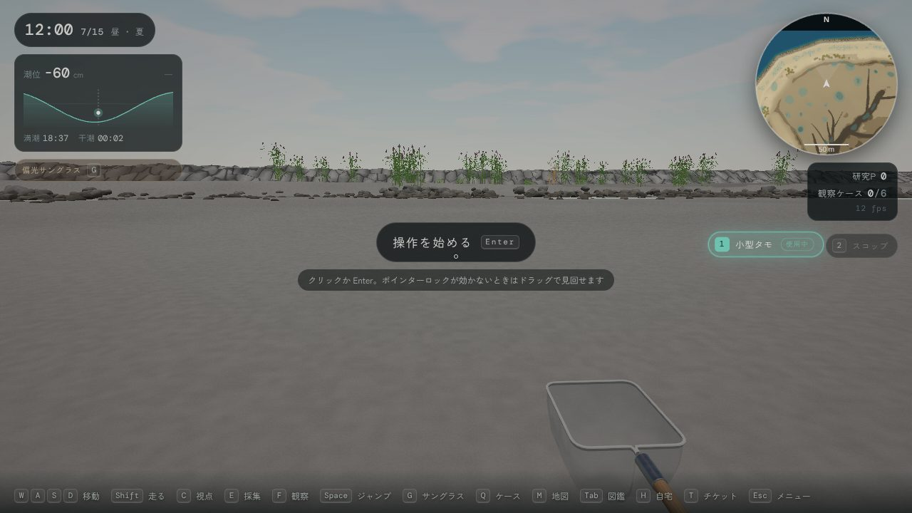

## 3. 砂の評価と砂紋

### 写真との比較（`tests/smoke/kasai-sand.mjs`）

夏の正午に、乾いた砂、引き潮の濡れた干潟、砂紋の接写、谷に水の残る砂紋を撮影し、画面中央の平均色を写真と比べながら調整しました（`node tests/smoke/kasai-sand.mjs --quality mid`）。

| 回 | 変えたこと | 乾いた砂（ゲーム内） | 濡れた干潟（ゲーム内） |
|---|---|---|---|
| 1 | 調整前 | 108,106,102（比 1 : 0.978 : 0.944、灰色すぎ・暗い） | 100,98,96（暖色寄り） |
| 2 | 砂の補正を強める、濡れを青みのある無彩色へ | 114,110,104 | — |
| 3 | 砂紋の高さと陰影を強める、補正をさらに暖かく | 117,113,105 | 濡れが水際しか出ていない |
| 4 | 直前の満潮線より下は一面に濡れたままにする | 116,112,104 | 93 前後の灰色（写真より暗い） |
| 5 | 濡れの暗さを和らげ、つやを足す。補正 1.36, 1.18, 0.92 | 121,115,106（比 1 : 0.956 : 0.878） | 102,100,95（比 1 : 0.98 : 0.94） |
| 6 | 砂紋の波長を写真に合わせて 10 cm に、シートを細かく | 同上 | 同上 |

| 乾いた砂 | 引き潮の干潟 |
|---|---|
| 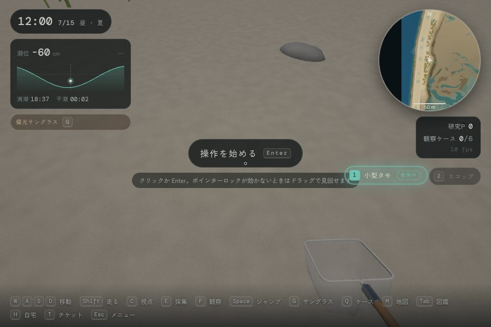 | 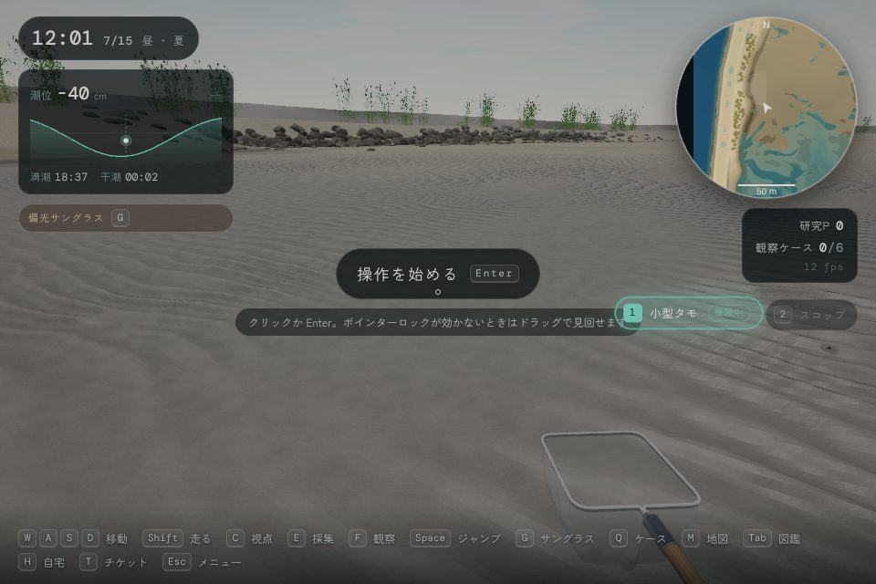 |

### 立体の砂紋

砂紋は、写真（p.16）のような波長 10 cm 前後の高まりです。高さは片側 1.5 cm まで。最低画質以外では、模様ではなく本当の凹凸にしています。プレイヤーの周り（半径は低 2 m・中 3 m・高 4 m）に 1.25 cm 間隔の細かい網目（砂紋シート）を置き、頂点を砂紋の形に持ち上げます。下の粗い地形はシートの下へ 5 cm 沈め、シートの縁で元に戻します。シートの網目はプレイヤーと一緒に動きますが、頂点は地面上の決まった位置に置かれるので、砂紋は揺れません。

- シートは、粗い地形が沈んでいる円の内側にだけ描きます（その外は粗い地形がシートと同じ面に戻っているので、粗い地形をそのまま見せる）。2 つの面が同じ場所に重ならないので、深度のオフセット（polygonOffset）は使いません。オフセットがあると、水のパスが深度から読む地面が数 mm 浮き、寄せ波の数 mm の水膜がシートの上だけ消えて、プレイヤーについて動く四角が見えていました。

- 谷は本物のくぼみなので、潮位や潮だまりの水面より低い谷には、水がそのまま入ります（水面は画面の奥行きから描いているため）。
- 潮が引いた直後の濡れた砂では、谷に薄い水の膜が残ります（暗く、つやがあり、空を映す）。残り方はまだらで、すぐ乾く場所と、谷ごとに水が残る場所があります。
- 砂紋はランダムに変わります。間隔は約 7〜10 cm、高さや片側の急さも場所によって違います。山は曲がりくねり、枝分かれと合流があり、砂紋のない平らな砂地も混じります。
- 最低画質では、平らな地面に陰影を描くだけです（板ポリ）。
- 形と陰影は同じ関数（`rippleHeight`、`rippleProfile`）から作るので、凹凸と陰影はずれません。

| 中画質: 谷に水が残る砂紋 | 最低画質（平面に描くだけ） |
|---|---|
| 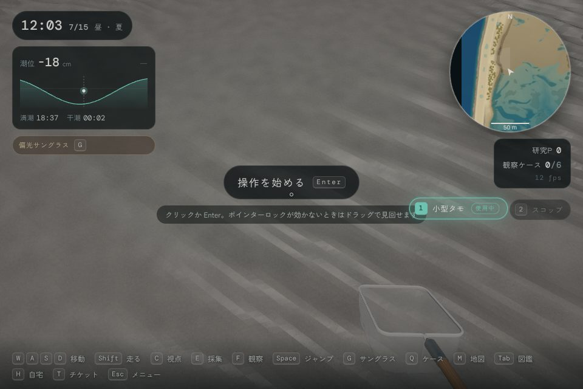 | 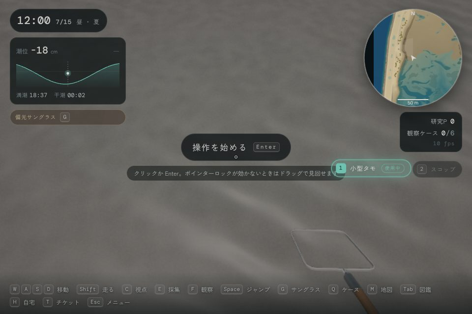 |

## 4. ヨシ（3 種、季節で割合が変わる）

堤の内側の縁のバーム（T.P. +1.0〜2.4 m の平らな砂地、石積みの上は除く）に、群落として**少しだけ**生えます（堤の全長の 3 割ほど）。株ごとに乱数を一つ持たせ、季節ごとの割合で種類を決めます。そのため季節が変わると、同じ株が若いヨシ → 緑のヨシ → 黄金色のヨシと移り変わります（`src/world/ReedBed.ts` の `REED_MIX`）。

| 季節 | 若いヨシ（春） | 緑のヨシ（夏） | 黄金色のヨシ（秋冬） |
|---|---|---|---|
| 春（3〜5 月） | 65% | — | 35%（去年の枯れ茎が残る） |
| 夏（6〜8 月） | 10% | 85% | 5% |
| 秋（9〜11 月） | — | 40% | 60% |
| 冬（12〜2 月） | — | — | 100% |

| 種類 | 形 |
|---|---|
| 若いヨシ | 高さ 0.45〜0.9 m、明るい緑、葉は立ち気味、穂なし |
| 緑のヨシ | 高さ 2.0〜2.8 m、濃い緑の葉が弓なりに垂れ、穂は紫がかった褐色 |
| 黄金色のヨシ | 高さ 1.8〜2.6 m、麦わら色、葉は少なく垂れ下がり、穂は銀色がかった淡褐色。ときどき折れた茎がある |

茎と葉は風で揺れます（株ごとに位相をずらし、根元は動かない）。株の密度は画質設定で変わります（1 m あたり 0.9〜3.2 株）。ミニマップでは、その季節の割合で混ぜた色の点として描きます。

| 春 | 夏 | 冬 |
|---|---|---|
| 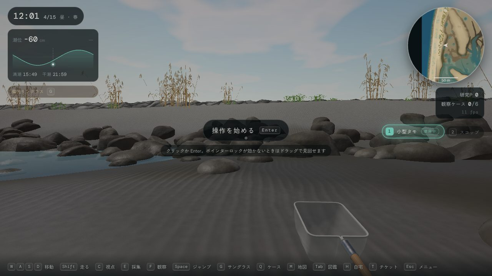 | 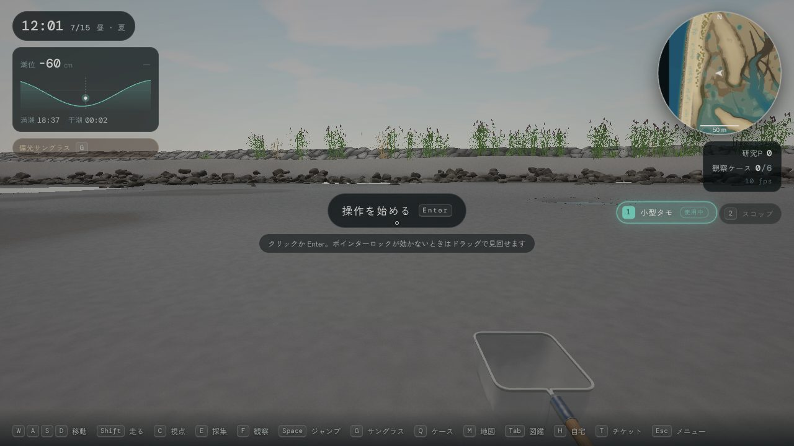 | 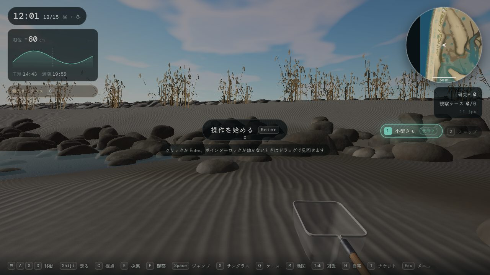 |

## 5. 竹杭とマガキ

口元の西寄りの浅瀬に、古い竹杭の列が少しあります（地図データ `stakes`、14 本、2 割ほどは朽ちて短い）。杭の T.P. +0.38〜−1.15 m の帯（堤の石と同じカキの帯）に、マガキが下ほど密に付きます。マガキは、堤の足元の捨石・ゴロタ石、潮間帯の堤の面にも付きます（捨石とカキの付着場所は `levee.path` をたどって配置する）。

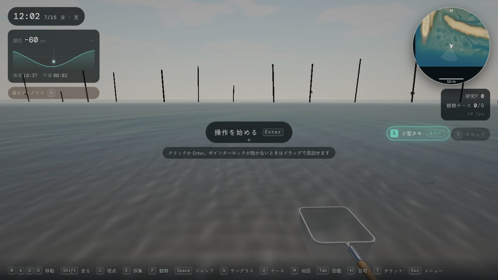

## 6. コード

| ファイル | 役割 |
|---|---|
| `public/data/maps/kasai_west.json` | `levee`（堤の中心線・天端・勾配・沈む長さ）と `stakes`（竹杭の列） |
| `tools/terrain/bake-map.mjs` | 地形と底質の焼き出し（堤・バーム・起伏と潮だまり・澪・泥干潟） |
| `src/world/LeveeLine.ts` | 堤の中心線を弧長でたどる（位置・向き・内向きの法線） |
| `src/world/Riprap.ts` | 捨石・ゴロタ石とカキの付着場所（堤の線に沿う） |
| `src/world/ReedBed.ts` | ヨシ（3 種、季節の割合、揺れ、ミニマップの色） |
| `src/world/StakeRow.ts` | 竹杭とそのカキの付着場所 |
| `src/world/Terrain.ts` | 堤の見た目（平らな面、高さによる色の帯）、砂紋（シェーダー共通の砂紋の関数、砂紋シート、谷の水）、濡れ |
| `src/ui/hud/mapImages.ts` | ミニマップと全体図の色 |

## 7. 未対応・今後

- 遠景（スカイツリー、観覧車、ゲートブリッジなど）は今回も出していない（`World.ts` の 1 行で戻せる）。
- 色の基準は夏の晴天。曇りの日や季節による地面の色の違い（冬の泥の色など）は、まだ調整していない。
- 生き物の出現場所は底質と高さから自動で決まるので、新しい配置にそのまま従う。種ごとの出方の微調整はしていない。
