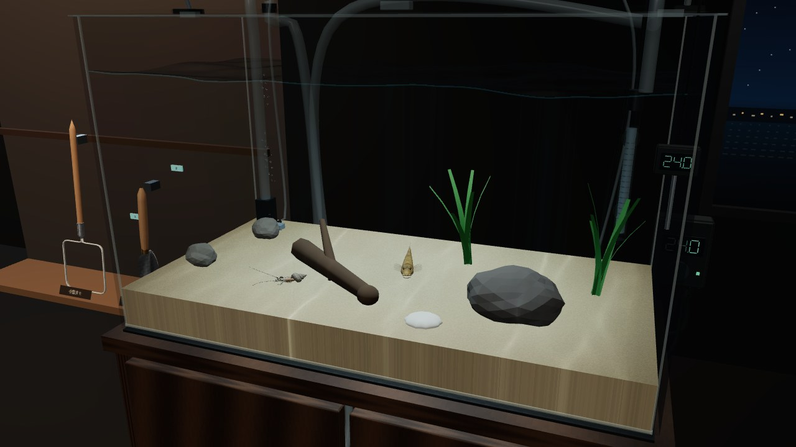
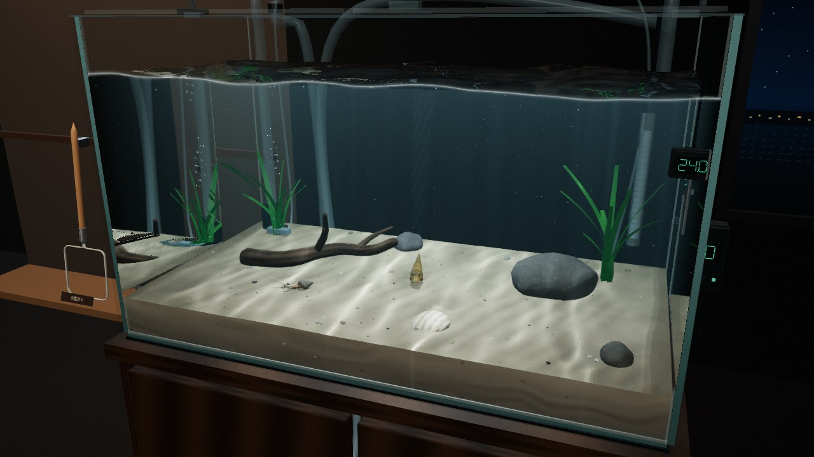
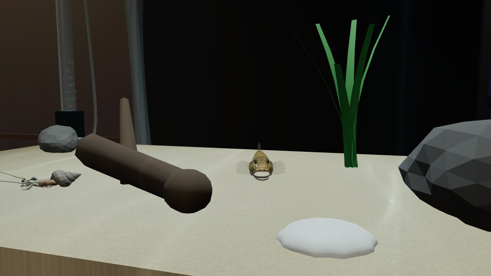
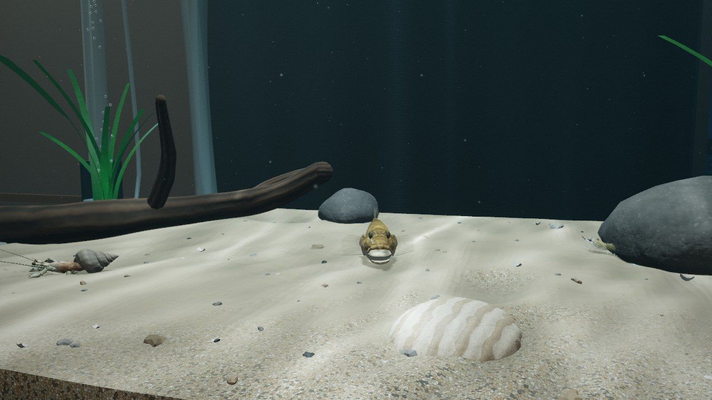
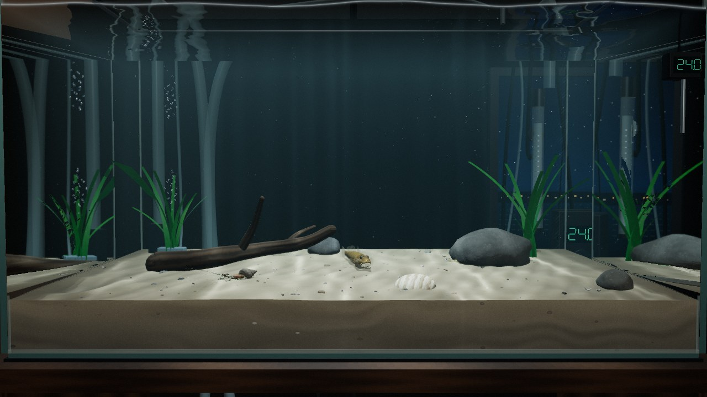
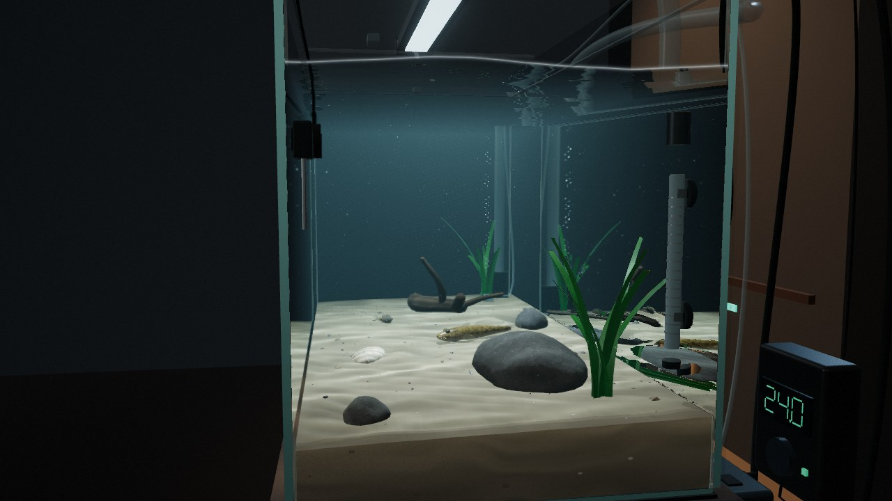
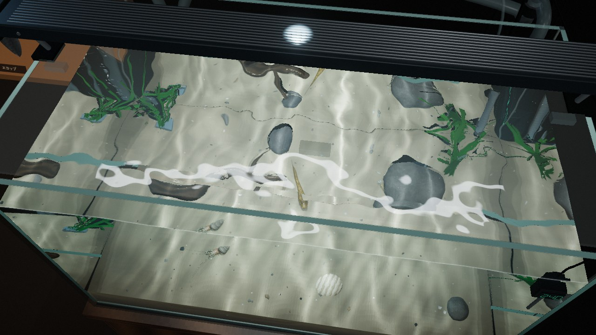
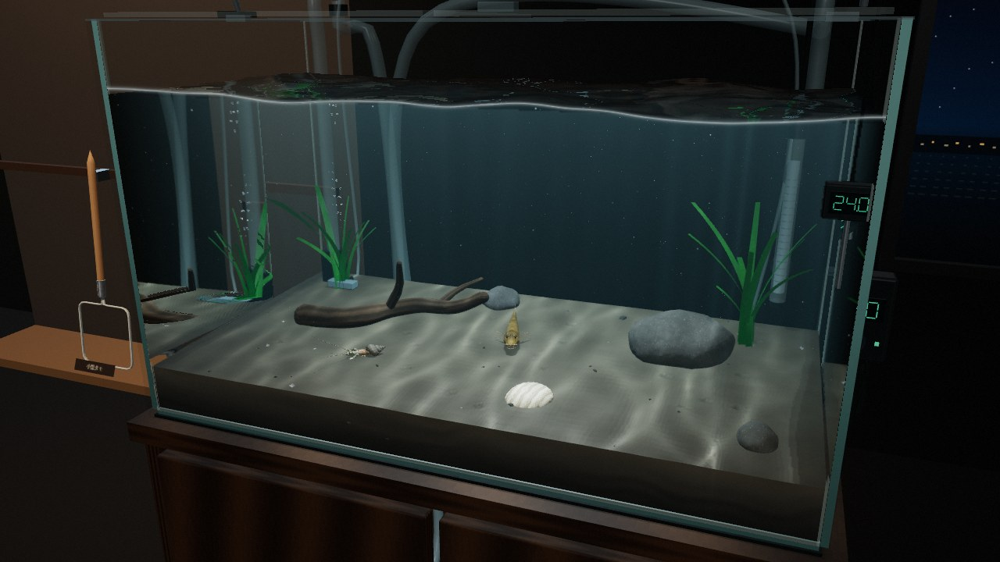
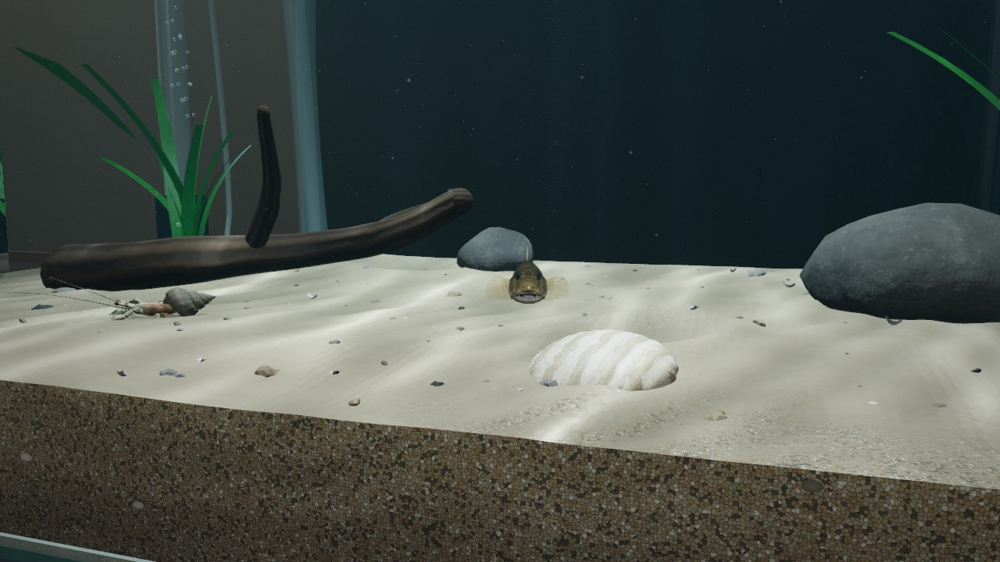

# ホームの水槽：水・光・底床の描画

ホームの水槽は専用の HDR パイプライン（`src/render/tank/`）で描く。水槽だけを眺めていても成り立つ絵を目標に、ガラス越し・水面越しの光学、水の体積感、底床と飾りの質感を作り直し、同時に旧版より軽くした。

| 旧版 | 新版 |
| --- | --- |
|  |  |
|  |  |

（同じ飾りと生き物、中画質、ヘッドレス Chromium で撮影。旧版はイソスジエビのシェーダーがコンパイルに失敗して描かれていない）

## 描画の流れ

`TankRenderer`（`src/render/tank/TankRenderer.ts`）が 1 フレームを次の順に描く。すべて線形 HDR。

1. **不透明パス**：水とガラスの面を除いたシーンを 1 回だけ、深度付きのバッファへ（ミップマップ付き。水越しの像のにじみと魚の皮膚の透けに使う）。
2. **ヒーロー魚**（マハゼの体積マテリアル）がいるとき：バッファを色と深度ごと複製し、鰭を元のバッファへ（体が透かして見る背景）、魚本体を複製側へ描く。旧版はシーン全体を 2 回描いていた。
3. **光の筋**：水の中だけを半解像度でレイマーチ（`WaterPasses.ts` の `SHAFT_FRAG`）。
4. **水とガラス**：全画面 1 パス（`WATER_FRAG`）。水槽の箱の外はシーンを色と深度ごとそのまま通し、箱の中を計算する。続いて水面より上の透明物（ガラス蓋、縁の透明トリム。`LAYER_OVER`）をその上へ描く。
5. **仕上げ**（`TankPost.ts`）：ブルーム（ミップチェーン）、露出、ACES、暗部をわずかに青緑へ寄せるグレード、ビネット、フィルムグレイン兼ディザ。内部解像度を下げたときはコントラスト適応のシャープ。

## 水の光学（`WATER_FRAG`）

画素ごとに、不透明シーンの色と深度から次を求める。

- **前面ガラス**：外面と内面の 2 面のフレネル反射に、部屋の映り込み（後述のキューブマップ）と LED バーの帯。斜めほど厚く通る緑がかった透過色。
- **水への入り方**：ガラス面から（平らなガラスでは像をずらさない。ずれは小さく一様で、画面空間で探すと輪郭が二重になるため）、波打つ水面から（水面の傾きで屈折し、像が揺らぐ。数ステップのセカント法で深度バッファ上の到達点を探す）、カメラが水中なら直接。
- **水から出る光線**：
  - 水面を下から見ると、臨界角の内側（スネルの窓）では部屋と LED が、外側では水面が完全な鏡になり、砂と生き物が映る。
  - 側面・背面のガラスを斜めに見ると、ガラス外面での全反射で鏡になる（水槽の「どこまでも続く側面」）。
  - それ以外はガラスを抜けて部屋へ。
- **水の体積**：経路長に応じた Beer–Lambert 吸収（赤から先に減る）、水そのものの散乱光、半解像度の光の筋、ガラスに沿って水が這い上がるメニスカスの細い明線。
- **水面の細波**：シミュレーションの格子より細かい 3 方向の短い波を法線に足し、LED の映り込みをきらめきに分ける。画素より細かくなる距離では消す。

水面そのものは旧版の CAUSTIC//LITE 方式（20 本の波＋GPU の波紋シミュレーション、`TankWaterSim.ts`）を引き継ぎ、コースティクスを底床の実際の高さへ投影するようにした。

## 光

- **コースティクス**（`causticMaterial.ts`）：LED のスポットライト（影付き・ハイライト付き）を、コースティクスの網を自身のぼかした平均で割った模様で変調する。明るさを保ったまま網目が影と鏡面反射にも乗る。水の分散で網の線の外側がわずかに色づく。網の照らす砂が生き物の腹側を下から照らす。
- **光の筋**（`SHAFT_FRAG`）：視線に沿って数ステップ、各点で LED の減衰、スポットライトの影マップ（魚や石の影が筋を切る）、網の濃淡（水面近くは一様、深いほど網目の膜に集まる）、前方散乱の位相関数を評価する。
- **部屋の映り込み**（`RoomProbe`）：水槽の中心から部屋を 128px のキューブマップへ描く（水槽自体は隠す）。部屋が変わったときだけ描き直す（最短 0.5 秒間隔）。
- **浮遊物**（`Motes`）：微細な粒子が漂い沈む。CPU の毎フレーム処理なし、1 ドロー。網の濃淡に照らされ、LED の方を見ると前方散乱で光る。
- **気泡**：縁の銀色（全反射）と頭頂の強いハイライトを HDR で描き、ブルームで光る。
- **ガラスの切断面**：板の broad face は水のパスが描き、厚み 5〜10 mm の切断面だけをシーンに描く。鉄分の緑と、上ほど明るい導光。

## 底床（`Substrate.ts`）

- **起伏**：CPU 上の高さ場（約 3 mm 格子）。砂は広いうねり、パッチ状の非対称な砂紋（流れの来る側がゆるく、陰側が急）、魚が掘ったくぼみと周りの盛り上がり、後ろがやや高い敷き方。泥はなめらかで、ゴカイの巣穴と糞塊。メッシュと `heightAt` が同じ高さ場を使い、生き物と飾りはこの起伏の上に立つ。
- **粒**：近くでは粒の一つ一つ（石英・長石・暗色の岩片・貝殻片の色、粒ごとの丸み、粒間の陰、ときどき結晶面のきらめき）。粒が画素より小さくなる距離では平均色へ溶かし、ちらつかない。くぼみと砂紋の谷にはシルトがたまって暗い。
- **ガラス越しの断面**：粒、層理、深いほど暗く灰色（泥は茶色の表層の下が黒い）、ときどき小石や貝殻片。上から染み込む光で表層 1 cm が明るい。
- **小石と貝殻片**：インスタンス描画 2 ドロー。
- **底砂なし**：暗いガラス底に網とその照り返し。

## 飾り（`TankLayout.ts`）

石は細分化した球を頂点結合してから変形するので滑らか（旧版は面ごとの法線でカクカクしていた）。岩肌の色むら・結晶・バンプは物体座標のノイズ。流木は曲がったチューブの枝と分岐、木目に沿った溝。貝は放射肋・成長線・褐色の帯。水草はアマモ風の細長い葉の束で、根元から曲がって揺れる。水草と流木は 1 メッシュにまとめて描画回数を減らした。細かい凹凸は画素より細かくなると弱め、輪郭がギザギザにならない。

## 画質設定と負荷

| 設定 | 光の筋（半解像度のステップ数） | 浮遊物 | 屈折の探索 | ブルーム | MSAA | 影 | 内部解像度の下限 |
| --- | --- | --- | --- | --- | --- | --- | --- |
| 超軽量 | なし | なし | 1 | なし | なし | なし | 60% |
| 低 | 6（超軽量の水では半分） | 350 | 2 | あり | なし | なし | 60% |
| 中 | 10 | 800 | 2 | あり | 4× | 1024、隔フレーム | 65% |
| 高 | 16 | 1400 | 3 | あり | 4× | 2048、毎フレーム | 75% |

- **動的解像度**：`EXT_disjoint_timer_query_webgl2` が使えるときは GPU 時間（目標 10 ms）、使えないときはフレーム時間から、内部解像度を 5% 刻みで上げ下げする。下げたときは仕上げでシャープをかける。デバッグ表示（`?debug`）に `水槽 1280×720 100% GPU 6.2ms` のように出る。
- **透過マテリアルの廃止**：旧版のガラス蓋とヒーターのガラス管は透過（transmission）マテリアルで、three.js はこれがあるだけで毎フレームシーン全体をもう 1 回描いていた。反射だけの薄いガラスに替えた。
- **ヒーロー魚**：シーンの 2 回描画をやめ、魚だけを描く 2 つの小さなパスと 1 回の複製にした。
- 影マップは中以下で隔フレーム更新。水面より上の透明物がないときはその描画を省く。毎フレームの `update` からオブジェクト生成をなくした。

ヘッドレス Chromium（SwiftShader、960×540、中、マハゼ・イソスジエビ・ユビナガホンヤドカリ＋石・流木・水草）で 1 フレームの描画時間を同条件で比べた（ソフトウェア描画なので実機の絶対値ではなく相対比較）。

| | 旧版 | 新版 |
| --- | --- | --- |
| ヒーロー魚なし | 2147 ms | 1949 ms |
| ヒーロー魚あり | 5854 ms | 3050 ms |

旧版の数値には、イソスジエビのシェーダーが水槽用のコピーで `PAT_MODE` の define を失ってコンパイルに失敗し、描かれていなかった分も含まれる（新版で修正。`cloneForTank`）。

## 画面

| | |
| --- | --- |
|  正面。水の青緑の奥行き、上は水面の裏の鏡、左右は側面ガラスの全反射の鏡、手前は砂の断面 |  側面から。光の筋と水面の裏 |
|  真上から。水面越しに揺らぐ像と LED の映り込み、奥と横のガラスの全反射 |  泥の底床 |
|  マハゼの体積マテリアルと、ガラス越しの砂の断面 | |

## 確認

```bash
npm run build
CHROMIUM_PATH=/opt/pw-browsers/chromium node tests/smoke/aquarium-water.mjs   # 4 つの画質、底床、水中視点、エラーなし（tests/smoke/out/water-*.png）
```
