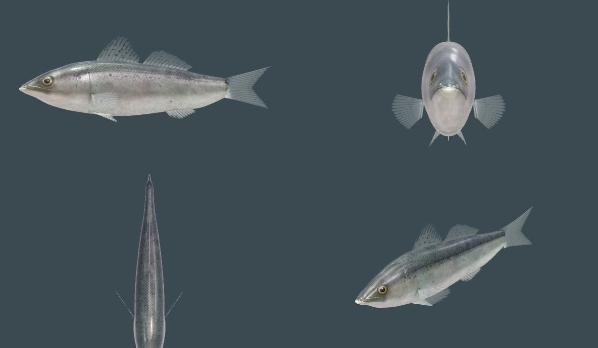
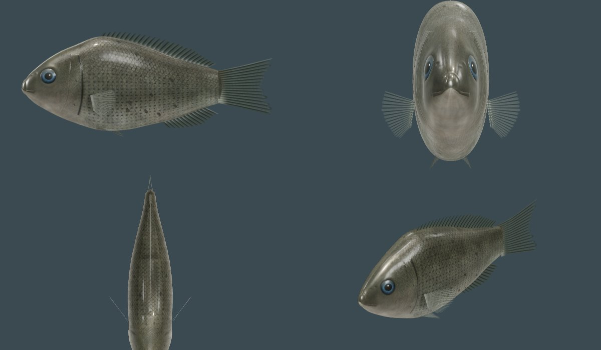
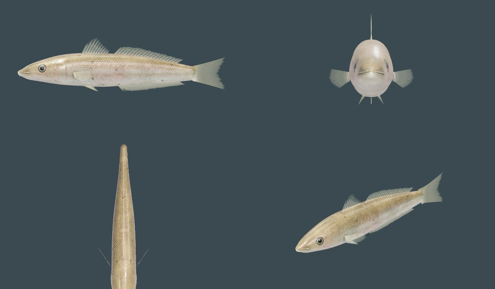
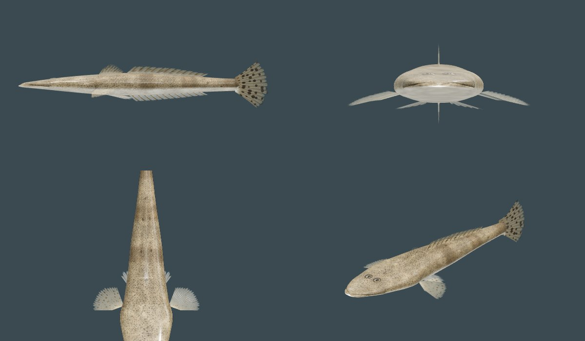
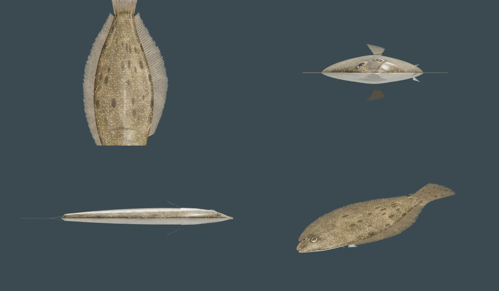
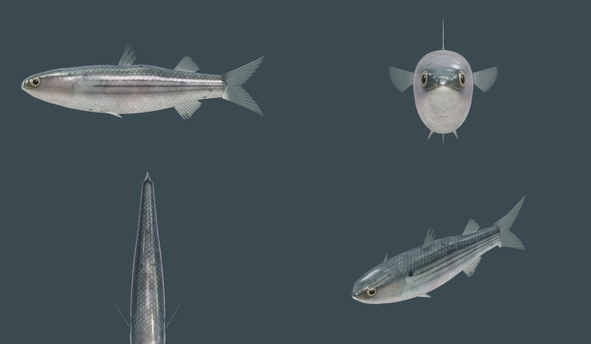
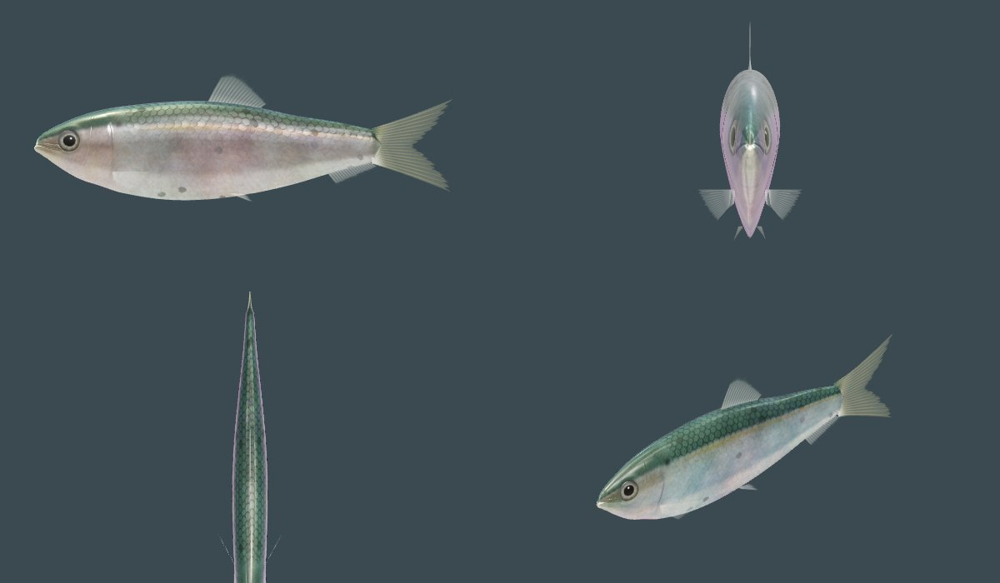
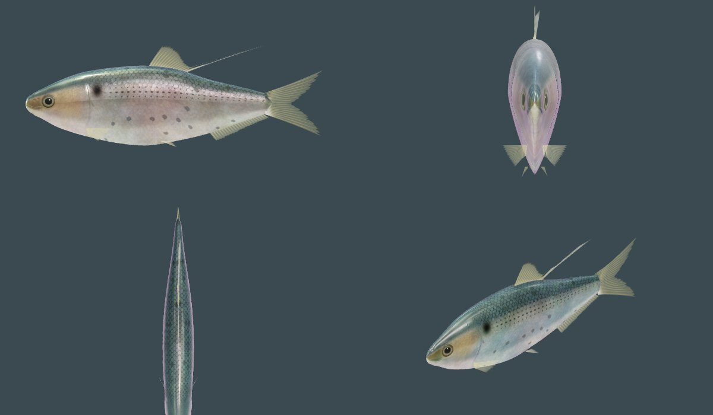
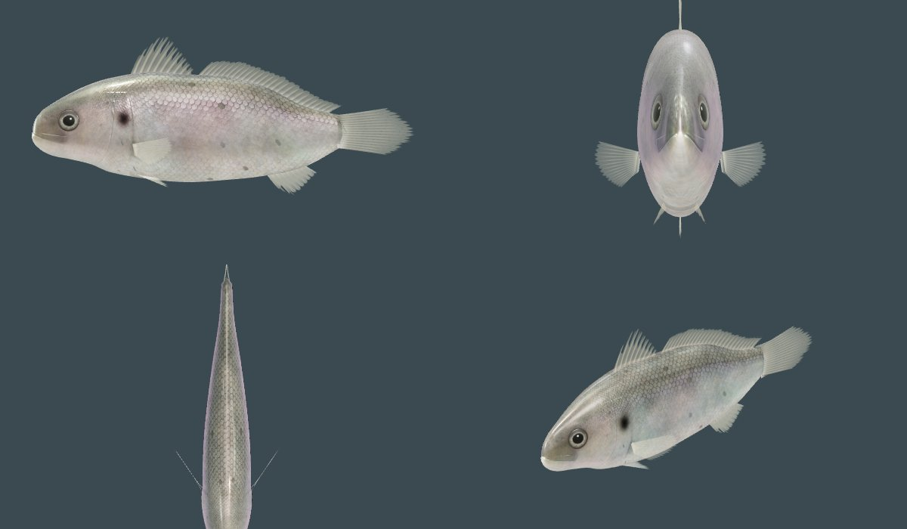

# 沿岸の魚（手続き生成）

スズキ、メジナ、シロギス、マゴチ、ヒラメ、ボラ（成魚）、サッパ、コノシロ、イシモチ（シログチ）。1 つの仕組み（`src/creatures/fish/`）に、種ごとの差分（`species.ts`）を載せている。

| ファイル | 中身 |
|---|---|
| `spec.ts` | 種の記述の型。体の背・腹の輪郭と幅（全長に対する割合の表）、断面の形（上下の膨らみと最も幅の広い高さ）、吻の丸み、口裂と口角（下顎の突き出し）、眼、鰓蓋の縁、鱗、側線、ひれ、泳ぎ（体の硬さ、胸びれで漕ぐ速さ） |
| `body.ts` | 共通の骨格（脊椎 8・下顎・左右の胸びれ・左右の鰓蓋・両眼・尾びれ）と 3 段階の形。口は本当に開き（下顎が骨、口の内側の面がある）、鰓蓋は骨で開いて奥の鰓室が見える。眼は頭の皮膚がふくらんだ角膜。ひれは根元が厚い |
| `relief.ts` | 頭の大きな形（鰓蓋のふくらみ、眼の下と前のくぼみ、上顎と唇の張り出し）を形に、細かなつくり（唇と口裂の溝、上顎の板、眼窩の縁、鼻孔、前鰓蓋の縁、鰓蓋の縁と影）を法線と陰に |
| `skin.ts` | 共通の PBR。本体（色＋金属感、面＝法線の xy・粗さ・AO、粘液の膜の重さと体の薄さは頂点色）、ひれ（分岐する鰭条、そろわない長さ、裂け目、厚い根元、透ける膜）、眼（虹彩のテクスチャ） |
| `shaders.ts` | 体・ひれ・眼のシェーダーの差分。水中の光（スネルの窓、砂の照り返し、コースティクス）はハクと共通。遠景（LOD2）は粘液の筋・透過・鰭条を省く |
| `rig.ts` | 泳ぎの姿勢（体を伝わる波＋曲がり、遅れてしなる尾びれ、胸びれ、下顎、鰓蓋、眼、ひれの波）と LOD の切り替え（画質の設定に従う） |
| `motion.ts` | 共通の行動。IDLE・SWIM・TURN・FORAGE・ESCAPE と、種によって REST・BURY・STRIKE・LEAP・ALERT。採餌の仕方は種ごと（hunt・pick・dig・ambush・graze・filter・peck）。泳ぎは状態で変わる（下） |
| `school.ts` | 群れ。1 群れに 1 つの状態、近くの仲間との分離・整列・結合だけの軽い処理。驚きの波、コノシロの一斉の方向転換 |
| `FishDriver.ts` | ゲームとのつなぎ（`drivers/index.ts` に登録）。ボラは 20 cm からこちら、それより小さいハク・スバシリは従来どおり |

ヒラメは同じ骨格を、無眼側を下に寝かせた体の枠に入れている（波は上下に伝わり、縁のひれが波打つ）。眼は 2 つとも左側、口は大きい。マゴチは縦扁した頭（幅 0.2 TL・高さ 0.06 TL）、上を向いた小さな眼、底に広げる胸びれ・腹びれ。

## 見た目と動きで気をつけていること

- 断面: 楕円ではなく、種ごとに背の厚み、最も幅の広い高さ（多くは軸より上、頭では頬の高さ）、下顎の V 字、サッパ・コノシロの腹の稜、ボラの平らな頭頂。メジナは体高 0.37 TL に対して幅 0.17 TL（正面から見て厚い）、ボラはほぼ円筒。
- 頭: 鰓蓋のふくらみ、眼の下と前のくぼみ、上顎と唇の張り出しは形で、縁の線や溝は法線と陰で。上顎と吻は頭の色、下顎は白い。
- 眼: 黒い球ではない。頭の皮膚がそのままふくらんだ浅い角膜（突き出さない）の下に、虹彩と瞳孔のテクスチャがある。見る向きで奥行きのぶんずれ、瞳の奥で水晶体が小さく光り、眼が動くと虹彩が角膜の中で動く。瞳は前に少し伸び（水晶体の前のすき間）、虹彩は上半分が背の色で暗い。色は種ごと（スズキの金、メジナの青、ヒラメ・マゴチの金褐色で瞳の上に房）。マゴチの眼は平らな頭の上に寄って並ぶ。
- 口: 閉じた口は暗い溝（唇の縁は濡れた光を抑える）。内側は奥ほど暗い口の中。スズキ・マゴチ・ヒラメは下顎が上顎より前に出る。
- 鱗: 1 枚ずつの形は作らず、面のテクスチャで。大きさは体の場所で変わり（頬・背と腹の縁・尾柄で小さい）、列は揺らぎ、1 枚ずつ明るさ・銀・傾きが違い、ときどき抜けている。櫛鱗の種は縁が粗い。側線の鱗には管と孔。銀の体側では鱗はほとんど見えない（銀は鱗の下に続いている）。
- 皮膚: 背の色素胞の点、色むら、銀の色の移ろい（背の青、頭の金と紫）、細いすり傷。粘液の膜は頭で厚く尾へ薄く、筋になってむらがある。体の縁と尾柄は光を透かす。頭・鰓蓋はなめらかで光り、背は粗く、鰓蓋の板がいちばん光る。鰭の付け根・腋・鰓蓋の縁の陰は AO に。
- ひれ: 根元は厚く（近い 2 段階は面が 2 枚）先へ薄く透ける。鰭条は先で分岐し、節があり、長さがそろわず、膜は鰭条の間で引っ込み、裂け目がある。尾の付け根は体の色で鱗に覆われる。光は鰭条に沿って筋になって返る。
- 曲がり: ふだんの旋回は大きな弧で、体の曲がりは種の硬さで決まる（ふだんは 0.9〜1.1/TL、速い急旋回は 2.2〜2.8/TL、C 字は逃げるときだけ）。遅いときは外側の胸びれで向きを変える。
- 泳ぎ方: 加速するときは尾を速く深く振り、減速するときは尾を止めて胸びれを広げる。ホバリングは胸びれで、メジナ・イシモチはゆっくり泳ぐ間は胸びれで漕ぐ。スズキ・メジナ・シロギス・マゴチ・イシモチは尾を 2〜4 回振っては滑る。群れの魚（ボラ・サッパ・コノシロ）は振り続ける。波長・尾の振幅・ひと振りで進む距離・体の硬さは種ごと。
- 呼吸: 口が開いて水を吸い、閉じて鰓蓋が開く（バッカルポンプ）。逃げたあとは速く深い。
- 軽さ: 遠景（LOD2）の魚は 1 フレーム 1 歩で動かし、姿勢は 1 フレームおき。20 匹を超える群れは、1 匹が 1 歩ごとに入れ替わる 16 匹の仲間だけを見る。

## 形の確かめ方

水中・水槽の生きた姿（iNaturalist の飼育下・生体の観察、Wikimedia Commons。9 種で約 330 枚、側面・正面・上面・斜め・遊泳に分けた）と、横・正面・上・斜め前・頭の拡大・水中（ゲームの水槽）のレンダーを種ごとに並べて比べた。写真は置かない。そこから直したこと: スズキの金色の虹彩と灰色の体側、メジナの眼の位置（高い）と茶灰色、マゴチの大きな胸びれと頭の上の眼、サッパ・コノシロの背のオリーブ色と金の帯、イシモチの灰銀色（桃色ではない）、全体に背を暗く体側を白すぎないように。

種ごとに 50 枚以上（52〜163 枚、9 種で約 1,000 枚）の写真を集め、全部を自動で切り抜いて（前景の切り出し、IS-Net）向きをそろえ、目で確かめて側面（マゴチは上面）として使える写真を選び、その平均の輪郭にモデルを合わせた。使った写真、写真の中央値の輪郭、モデルとの一致（IoU）は `reference.json`。

1. 集める: iNaturalist の観察（研究用グレード、足りない種は全グレードと Wikimedia Commons）。`measure/fetch.py`
2. 切り抜く: 前景のマスク（`measure/seg.py`、rembg の IS-Net の ONNX）
3. そろえる: 主軸で回し、尾柄のくびれで頭と尾を見分けて頭を左に、吻端と尾柄の中心を結ぶ線を水平に、吻端から尾鰭の端までを全長 1 に。モデルの輪郭も同じ処理にかける（`measure/profile.py`）
4. 選ぶ: 全部の写真を輪郭つきで並べた一覧から、体が切れず、手や他の魚と重ならず、横から（上から）撮った写真を選ぶ（`measure/review.py`）。種ごとに 8〜26 枚
5. 合わせる: 選んだ写真の平均の輪郭とモデルの体（ひれなし）の輪郭を比べ、背・腹の輪郭の表を直す（`measure/iterate.sh`、`fit.py`。写真のひれが体の輪郭を広げている区間は外す）。眼・口角・鰓蓋・胸びれ・模様の位置は、頭の拡大を写真と並べて読む（`measure/heads.py`）

| 種 | 集めた | 使った | 一致（IoU、ひれ込み） |
|---|---|---|---|
| スズキ | 120 | 19 | 0.83 |
| メジナ | 117 | 22 | 0.93 |
| シロギス | 132 | 22 | 0.79（写真ではひれを畳んでいる） |
| マゴチ（上面） | 120 | 8 | 0.73（上からの写真は胸びれの開き方がまちまち） |
| ヒラメ（有眼側） | 163 | 24 | 0.91 |
| ボラ | 120 | 10 | 0.86 |
| サッパ | 64 | 18 | 0.89 |
| コノシロ | 114 | 26 | 0.88 |
| イシモチ | 52 | 13 | 0.86 |

写真から分かって直したこと: メジナは腹側がずっと浅く（体高 0.36 TL）、背びれ・しりびれが体の輪郭の大きな部分。コノシロは体高 0.26 TL（1 枚の写真より細い）、肩の黒斑は側線より上。ボラは吻が体の中心線より高く（腹が深い）、頭は思ったより細い。シロギスは体の大部分が吻の線より上で、眼は小さく（直径 0.04 TL）後ろ寄り。スズキ・イシモチ・メジナの眼は前に寄りすぎていた。ヒラメの両眼は上の眼が少し前。

```
node tools/models/fish/render.mjs               # 側面・正面・上面・斜め（docs/models/fish/<種>.jpg）
node tools/models/fish/render.mjs --head 1      # 頭の拡大
node tools/models/fish/render.mjs --photo --out public/data/photos   # 図鑑の静止画像
node tools/models/fish/render.mjs --mask side --body --out <dir>     # 写真と比べる輪郭（measure/）
node tools/models/fish/render.mjs --water 1     # 水中で横から（2 頭の拡大、3 後ろのひれ、4 斜め前、5 正面、6 上）
# ゲームの水槽で（npm run build のあと）: 近くから横・斜め、または 1 匹を追った連続のこま（0.1 秒ごと、d < 0 は上から）
node tests/smoke/aquarium-fish.mjs <dir> lateolabrax_japonicus:300,girella_punctata:180
node tests/smoke/aquarium-fish.mjs <dir> lateolabrax_japonicus:300 --seq 0 16 1.3
```

| 種 | 4 方向 |
|---|---|
| スズキ |  |
| メジナ |  |
| シロギス |  |
| マゴチ |  |
| ヒラメ（上から見たのが「側面」） |  |
| ボラ（成魚） |  |
| サッパ |  |
| コノシロ |  |
| イシモチ |  |

容量は [容量予算](../../quality/model-budget.md) の §5。
