# 波打ち際 — 砕波・白波・遡上・引き波・濡れた砂

海岸マップ（いまは走水）の寄せ波を、浜にカメラを置いたときに実写の波打ち際に見えることを目標に作り直した。目標の画は、ユーザー提示の写真（浜から沖を見た順光の逆、太陽が沖の上にある朝）: 薄い引き波の水膜の向こうで波が立ち上がり、前面が瓶のような緑に透け、波頭が前へ巻き込みながら崩れ、その崩れが波頭に沿って横へ進み、海面と水膜の一面が太陽で強くきらめく、という「ショアブレイク」。

- ゲームの中: 走水海岸（潮位・日によって変わる海況で、干潟の上で崩れる波から、満潮時の急な前浜で巻き込む波まで）
- 波打ち際ラボ: `surf-lab.html`（開発時は http://localhost:5173/gerupamasini/surf-lab.html）。急な前浜・砂州・岩場のある合成の浜で、潮位・波高・周期・波向・時刻・画質・デバッグ表示・視点を変えられる。`?shot` で操作パネルを隠し、`?q=high` で画質を指定。

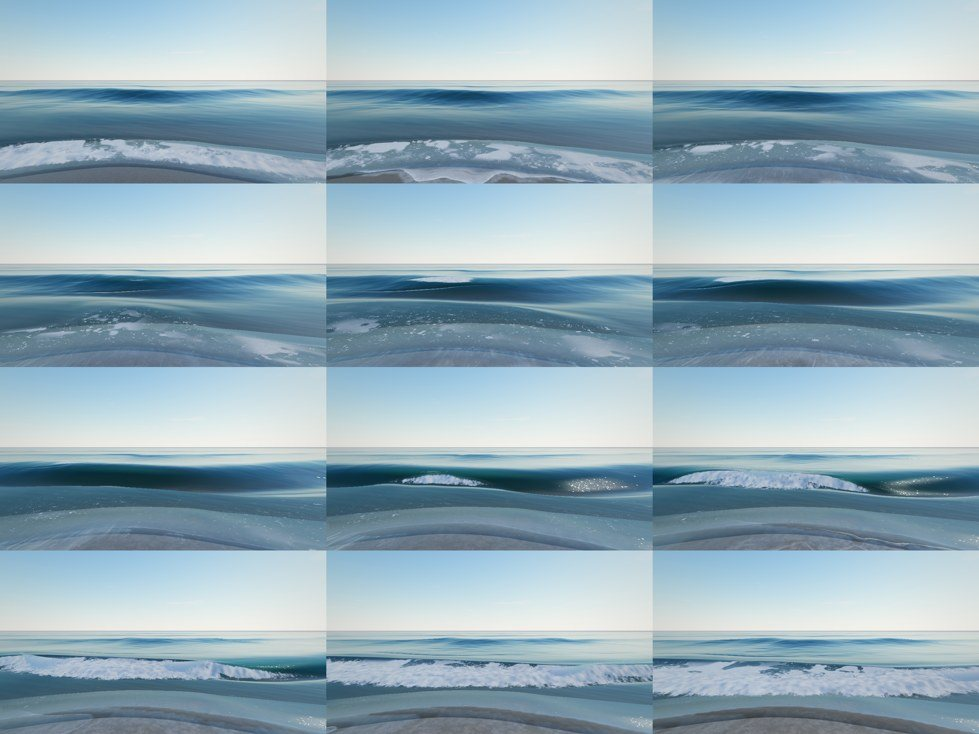

## 1. 調査

実物の波打ち際で起きることと、その量的な関係を文献で確かめ、それぞれを描画の仕組みに対応させた。式は `src/world/surfPhysics.ts`（TypeScript、テストと CPU 側の判定）と `src/world/Surf.ts`（GLSL、描画）の両方に同じ形で入っている。

| 現象 | 実物で起きること | 量的な関係（出典） | 実装 |
|---|---|---|---|
| 浅くなると遅くなる | 波の速さは浅瀬で √(gD)、深いと gT/2π。波頭の間隔が詰まり、斜めに来た波頭は岸と平行に回り込む（屈折） | 線形分散 ω² = gk tanh(kD)（Eckart 1952 の近似式で解く） | 地形と潮位から、沖の端から各点までの到達時間を c(D) の eikonal として掃引（`SurfZone`）。位相 = 時刻 − 到達時間 |
| 浅水変形（shoaling） | 浅くなるほど波が高くなる | Green の法則 H ∝ D^−1/4 | 沖の端の水深を基準に波高を増やす |
| 波形の変化 | 沖では正弦波、中間水深で峰が尖り谷が平ら（Stokes・クノイド）、砕波直前は前へ傾き前面が切り立つ | Ursell 数 Ur = (3/8) H k / (kD)³ から非線形性 B と位相 ψ（Ruessink et al. 2012）、その形を Abreu et al. (2010) の解析的な波形で描く | `surfShape` / `surfAbreu`。B と ψ から r, φ を求める関係（B = 3b/√(2(1−b²))、φ = −π/2 − ψ）は数値で確かめた（`tests/unit/surfZone.test.ts`） |
| 砕波の位置 | 波高が水深のある倍率に達すると崩れる。急な浜ほど浅くなるまで崩れない | Weggel (1972): γ = b(m) − a(m) H/(gT²)、a = 43.8(1 − e^−19m)、b = 1.56/(1 + e^−19.5m)。1:20 で約 1.07、1:9 で約 1.3 | 局所勾配ごとの砕波指標（`surfBreak`） |
| 砕波の形式 | 緩い浜では崩れ波（白い頂が前面を流れ落ちる）、急な浜では巻き波（前面が垂直に立ち、波頭が投げ出されて前の谷へ落ちる） | 砕波点の Iribarren 数 ξb = m/√(Hb/L0): 0.4 未満 spilling、0.4〜2.0 plunging、2.0 超 collapsing/surging（Battjes 1974） | `plunge`（0..1）で波形の前傾・崩れの速さ・泡の出方・波頭メッシュ・飛沫を切り替える |
| 砂州 | 大きな波だけ砂州で崩れ、トラフで再生し、前浜でまた崩れる | 沖側で越えた最も高い地盤（制御水深） | 到達経路上の最高地盤を焼き込み、砕波判定を制御水深で行う（深みに入ると段階的に再生） |
| 崩れた後 | 段波（bore）になり、高さは水深の 0.5〜0.6 倍まで縮む。前面に泡の渦（roller）、後ろに泡が残る | 飽和した段波 H ≈ 0.55 D | のこぎり形の段波、前面の roller、後ろの泡（年齢とともに薄れる） |
| 遡上（swash） | 段波が汀線で崩れて薄い水の舌になり、斜面を駆け上がって止まり、重力で戻る | Stockdon et al. (2006) の 2 % 遡上高 R2 = 1.1(0.35 βf √(H0L0) + ½√(H0L0(0.563βf² + 0.004)))、ξ0 < 0.3 では 0.043√(H0L0) | 日の海況と浜の勾配から R2、1 波ごとに波高の平方根で変える |
| 遡上の水膜 | 先端が弾道的に進み、後ろに薄いレンズ状の水、下ほど速い流れ | Shen & Meyer (1963): 先端 xs = U0t − ½g sinβ t²、水深 h = (xs − x)²/(9gt²)、流速 u = us + (2/3)(x − xs)/t | `surfSwashAt`。水膜の厚さと流速を解析的に求める。先端は摩擦で数 mm〜1 cm の丸い「鼻」 |
| 引き波（backwash） | 遡上より遅く長く続く（約 1.35 倍）。泡は斜面下ほど速い流れに引き伸ばされ、筋になって分裂する | 遡上と引き波の非対称（Swash, coastal wiki 等の現地観測） | 引き波の継続時間を 1.35 倍に。泡の模様を Lagrange 座標 t^(2/3) で斜面方向に引き伸ばす |
| 次の波との干渉 | 緩い浜では引き波が戻り切る前に次の遡上が乗り上げ、乱れた白い段になる（swash–swash interaction） | 遡上周期 > 波の周期のとき（Erikson et al. 2005） | 直近 3 波の遡上を同時に評価し、新しい遡上の先端が前の水膜に乗る所を「衝突」として泡にする |
| 不規則性 | 波ごとに高さ・周期・向きが違い、高い波は群れ（セット）で来る。波頭は一直線でなく、一部ずつ崩れる | 個々の波高はレイリー分布（平均 0.63 Hs） | 周期は時間軸のゆがみ（0.75〜1.5 倍）、向きは波ごとに揺らぎ、高さはレイリー分布 × 群れ × 波頭方向のむら |
| 泡 | 波頭の白波、崩れた後の白い渦と泡の膜、海面に残るレース、砂の上に残る細かな泡、遡上の止まった線（swash mark）、引き波で伸びる泡 | 現地観察（swash marks は遡上の最高点に残る細かな泡・砂粒・有機物の線） | 4 種類の泡を別々の式で作り、砂に残る泡は記憶バッファで流れに乗せて運ぶ |
| 濡れた砂 | 濡れると暗く、つやが出る。水膜が乗っている間と直後は空を鏡のように映し、水が砂に染みると艶が消え、乾くまで暗さが残る | Lekner & Dorf (1988): 砂粒の間の水膜で全反射と屈折率差が減り、吸収が増えて暗くなる | 記憶バッファの「水膜」（1.4 s で引く鏡面）と「飽和」（70 s かけて乾く暗さ）、粗さと空の反射を切り替える |
| 岩・障害物 | 岩の陰は波が小さく、波頭は岩を回り込む（回折）。岩の沖側の面では波が砕けて飛沫と泡 | Fresnel 帯の幅 √(λx/2π) | 直進の影を、進むごとにその幅でぼかした遮蔽係数。陰には横から遅れて波が届く到達時間。衝突面の焼き込みで泡と飛沫 |

参照した文献・資料

- Stockdon, H. F., Holman, R. A., Howd, P. A., Sallenger, A. H. (2006) Empirical parameterization of setup, swash, and runup. *Coastal Engineering* 53(7), 573–588. https://pubs.usgs.gov/publication/70030520
- Battjes, J. A. (1974) Surf similarity. *Proc. 14th ICCE*（Iribarren 数の閾値）。https://en.wikipedia.org/wiki/Iribarren_number
- Weggel, J. R. (1972) Maximum breaker height. *J. Waterways, Harbors and Coastal Eng. Div.* 98(4). https://ascelibrary.com/doi/10.1061/AWHCAR.0000166
- Ruessink, B. G. et al. (2012) On the parameterization of the free-stream non-linear wave orbital motion in nearshore morphodynamic models. *Coastal Engineering* 65（Ursell 数からの歪度・非対称度）。https://en.wikipedia.org/wiki/Wave_nonlinearity
- Abreu, T. et al. (2010) Analytical approximate wave form for asymmetric waves. *Coastal Engineering* 57.
- Shen, M. C., Meyer, R. E. (1963) Climb of a bore on a beach. *J. Fluid Mech.* 16.
- Erikson, L. et al. (2005) Shoreline motion from collapsing bores (swash interaction). https://data-ww3.ifremer.fr/BIB/Erikson_CE2005.pdf
- Swash（遡上と引き波の非対称、swash–swash interaction）: https://en.wikipedia.org/wiki/Swash 、https://www.coastalwiki.org/wiki/Swash
- Breaking wave / Plunging wave（反射的な浜のショアブレイク）: https://en.wikipedia.org/wiki/Breaking_wave 、https://niwa.co.nz/coasts/reflective
- Lekner, J., Dorf, M. C. (1988) Why some things are darker when wet. *Applied Optics* 27. https://www.wgtn.ac.nz/scps/staff/pdf/darkerwhenwet.pdf
- 参考シーン: aiimpl/clear-shallows（遡上の弾道モデル、等値線から作る糸状の泡、水膜の縁のメニスカス、乾いた砂と濡れた砂の境界）。https://github.com/aiimpl/clear-shallows

## 2. 全体の構成

```
地形(height) ─┐
潮位 ─────────┼─▶ SurfZone（CPU / Worker、潮位 4 cm ごと）
日の海況 ─────┘      到達時間・制御水深・遮蔽・衝突面・勾配 ──▶ tSurfZone / tSurfAux
                                                           │
             SURF_GLSL（Surf.ts）: 点・水位・時刻 → 波の高さ・砕波・泡・遡上 ◀─┘
                 │            │              │                │
            WaterPass     SurfMemory     SurfLip          SurfSpray
          （水面・泡・    （砂の記憶:    （巻き波の      （GPU 飛沫:
           きらめき）     水膜・飽和・    波頭メッシュ）    状態なし）
                 │        泡・線）
                 │            └──▶ Terrain（濡れた砂の色・粗さ・反射・泡）
                 ▼
            FieldRenderer（地形と物 → 水の合成 → 飛沫）
```

| ファイル | 役割 |
|---|---|
| `src/world/surfPhysics.ts` | 分散関係、Weggel、Iribarren、Stockdon、遡上の弾道、Ursell→波形、区分の判定、日の海況（TS） |
| `src/world/SurfZone.ts`, `surfZoneBake.ts`, `surfZone.worker.ts` | 地形と潮位から砕波帯を自動計算するテクスチャ（Worker で先回りして作る） |
| `src/world/Surf.ts` | 寄せ波の GLSL（`SURF_GLSL`）と uniform、泡のレースのテクスチャ |
| `src/world/Water.ts` | 画面空間の水: 波の立体（レイマーチ）、法線、反射・屈折・Fresnel、深さの色、泡 4 種、きらめき、水膜、デバッグ表示 |
| `src/world/SurfMemory.ts` | 砂の記憶（水膜・飽和・泡・遡上の線）のピンポン・バッファ |
| `src/world/Terrain.ts` | 濡れた砂（記憶を読む） |
| `src/world/SurfLip.ts` | 巻き波の投げ出される波頭（頂点シェーダで変形する帯メッシュ） |
| `src/world/SurfSpray.ts` | 飛沫と霧（GPU パーティクル） |
| `src/world/maps/surflab/` | ラボの浜の形と ShoreLayout |
| `src/lab/surfLab.ts`, `surf-lab.html` | 波打ち際ラボ |

## 3. 砕波帯を地形と潮位から自動で求める（SurfZone）

「深い・浅い・砕波帯・遡上帯」は、決め打ちの範囲でなく、地形の高さと現在の水位から毎回計算する。

1. 岸の座標（s: 沖へ、y: 岸沿い）の格子に地形を写し、**海**（沖の端につながる水域）、**陸**（陸側の端につながる部分。浜、潮だまり、護岸）、**岩**（海の中の乾いた島）に分ける。
2. 沖の端から陸へ、各セルの到達時間を位相速度 c(D) で掃引する（真っすぐ、または斜め 45° の一歩）。各行のあとで岸沿いに両方向へ緩和するので、岩の陰には横から、遅れて波が届く（回折）。浜のセルはその下の汀線の到達時間を受け継ぐので、遡上は自分を作った段波と同じ時刻で動く。
3. 遮蔽: 岩が作る直進の影を、一歩進むごとに Fresnel 帯の幅 √(λΔs/2π) で岸沿いにぼかす。陰は穏やかになるが、くっきり切れない。
4. 衝突面: 海に面した岩、急な陸の面（護岸）に印。そこへ波頭が来た瞬間に泡と飛沫。
5. 沖側で越えた最も高い地盤（砂州）と、海側への勾配（約 1.75 m で平滑化）は潮位によらないので一度だけ。

潮位は 4 cm の区間で扱い、区間の両端の水位で作った到達時間をシェーダが水位で混ぜる。潮が動いても波頭が跳ばない。区間を出る前に、潮の向かう側の区間を Worker で作っておく（走水の地形 385 × 385 で 1 水位約 40 ms、描画は止まらない）。チケットやデバッグで潮位が飛んだときはその場で作る。

区分（`classifyDepth`、ラボの HUD とデバッグ表示 1）: 陸は R2 より高い所、遡上帯は R2 から最大の波の砕波水深の 1/4 まで、砕波帯はその 1.15 倍まで（砂州の後ろのトラフは砂州の水深で判定）、浅い海は半波長より浅い所、その先が深い海。

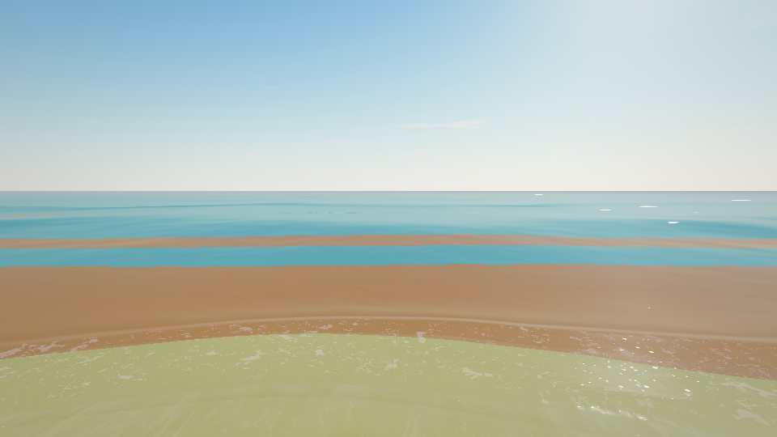

## 4. 波のモデル（SURF_GLSL）

すべて「点・水位・時刻」の関数で、状態を持たない（スマホでも PC でも同じ計算量、長く遊んでもずれない）。

- **位相**: 到達時間を引いた時刻をゆっくりした雑音でゆがめ（各波の周期が 0.75〜1.5 倍）、岸沿いの位置 × 波向の正弦 / 沖の速さを足す（Snell の法則: 岸沿いの波数は水深によらず一定なので、斜めに来た波頭は浅くなるにつれて岸と平行に回る）。波向は波ごとに揺らぐ。さらに 70 m・18 m・5 m の 3 段階で波頭を曲げる。
- **波高**: 波ごとにレイリー分布（平均 0.63 Hs）× 6 波ほどの群れ × 波頭方向の区間ごとのむら（10〜20 m と数 m）。谷の間で次の波の高さへ移る。
- **浅水変形と波形**: Green の法則で高くし、Ursell 数から Abreu の波形の (r, φ) を決める。沖では正弦波、中間水深で峰が尖り（Gerstner 的な形）、砕波に近づくと前傾。
- **砕波**: 制御水深（砂州）での波高 / (γ × 水深) が 1 を超えると崩れ始める。崩れ波は 1.9、巻き波は 1.25 で段波になり切る。
- **段波**: 高さは水深の 0.55 倍まで縮む。前面に roller、後ろに泡（年齢とともに薄れる）。岸沿いに強弱がある。
- **遡上と引き波**: 直近 3 波の遡上を同時に評価。各波の遡上高は Stockdon の R2 × √(波高/Hs)、先端は弾道、引き波は 1.35 倍の時間で戻り、静水面の下まで水を引き下げる（次の段波の前に砂が見える）。水膜の厚さ（Shen–Meyer のレンズ + 先端の鼻）と流速を返す。

| 崩れる波を横から（前面を流れ落ちる白波、巻き込む波頭） | 浜沿い（斜めに入る波の崩れが波頭に沿って走る、カスプのある前浜） |
|---|---|
| 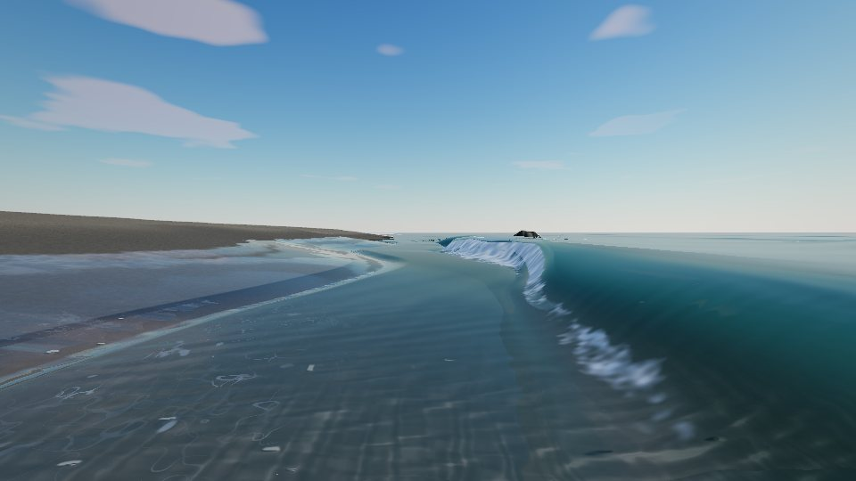 | 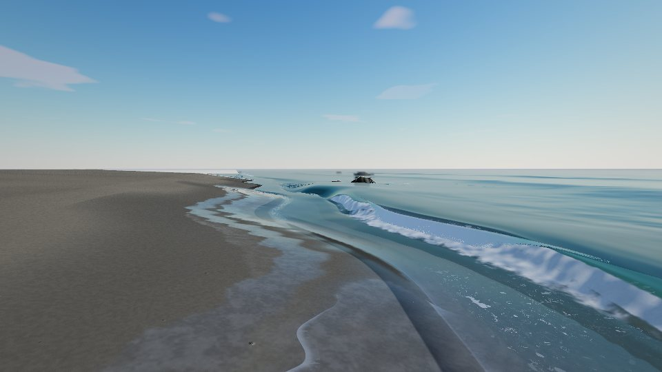 |

## 5. 水面の描画（WaterPass）

既存の画面空間の水（地形と物を HDR に描いてから、深度から水面と底を求めて合成する方式）を土台に、次を足した。

- **立体の波（近距離）**: 視点から約 35 m 以内は視線を波面に対してたどる（中 12 歩・高 16 歩、目の近くほど細かい歩幅 + 割線法）。波頭が奥を隠し、前面が面として見える。法線は波面そのものから差分で測る。
- **遠距離**: 平面に描き、波の解析的な勾配（Snell で曲がった進行方向）で法線を傾ける。さらに遠くは小さな波の法線だけ。
- **沖の風浪**: 開けた海岸だけ（`layout.water.chop`）、水深のある所に 4 オクターブの風浪の法線層（2 層ずつ別向きに流れ、画素の大きさに近づいたオクターブから消す）。
- **反射・屈折・Fresnel**: 既存の映り込み（陸と空）とキューブマップ。薄い水膜は鏡として Fresnel を強める。屈折は水の厚さに比例。
- **深さの色**: 水の厚さによる減衰と散乱（`setBody`）。砕波帯は砂が舞って濁り、砂色の緑に。
- **波の前面**: 前面は空の光が遮られて暗く、薄い頂は瓶のような緑に透ける（太陽が向こうにあるほど明るい）。
- **きらめき**: 小さな波の面をランダムに傾けた「面」を画素の大きさのセル（2 段階）で置き、太陽を目に返す面だけが光る（Cox–Munk の傾きの広がり）。水平線まで続き、太陽の帯に細くなる。各セルの面は 1 秒に数回引き直して瞬く。遡上の水膜の上でも光る。
- **泡 4 種**:
  1. 波頭の白波（崩れ始め）: 波頭に沿って伸びた筋。崩れ波は頂から前面へ流れ落ちる。巻き波は投げ出されるまで透明。
  2. 崩れた後の白波（roller）: 段波の前面とその直後。前へ転がる塊（2 オクターブの雑音が段波とともに動く）、厚い所はほぼ白、塊どうしの影で暗い筋。
  3. 海面に残る泡: Voronoi の壁（2 サイズ、ゆがめて途切れさせたもの）と等値線の糸（参考シーン）。波ごとに模様が変わり、岸へ漂い、年齢とともに薄れる。
  4. 遡上と引き波の泡: 駆け上がる先端の泡の帯、前の引き波への乗り上げの線、引き波で斜面方向に引き伸ばされる筋（t^(2/3)）、砂の記憶に残る泡。
     - 筋の模様は、水膜の一粒ずつの目印で描く。目印は「先端からの距離 ÷ (t + 0.3)^(2/3)」（`Surf.swDx`）。Shen–Meyer の水膜では、一粒の先端からの距離がちょうど t^(2/3) で伸びるので、模様は水と一緒に流れて伸びるだけで、水より速くは動かない。
     - 水膜のさざ波の筋（法線）も同じ目印で描く。
- 泡の明るさは水が映す空と同じ空から取るので、泡はいつも周りの水より明るい。

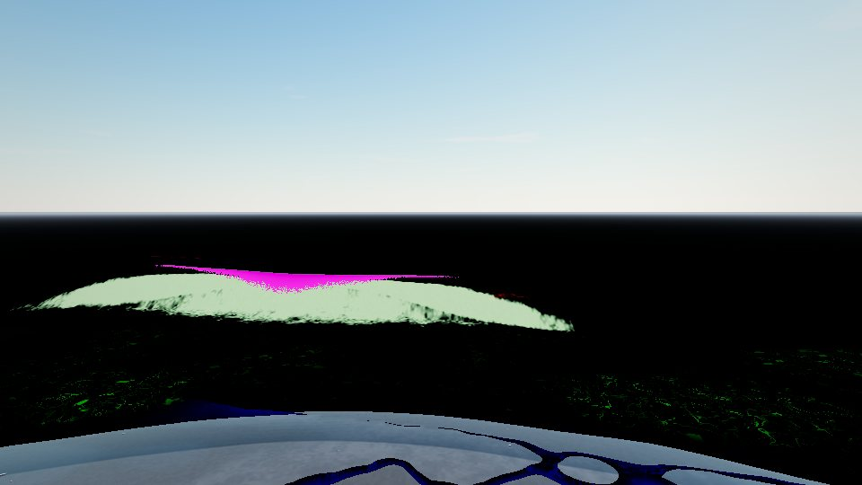

## 6. 砂の記憶と濡れた砂（SurfMemory, Terrain）

視点のまわり 40 m（中・高）/ 32 m（低）の窓に、毎フレーム（低は 1 フレームおき）次を記録する。各テクセルは自分の点の遡上（水が描くのと同じ関数）と、一瞬前の自分の値を読む。泡だけは水膜の水が一瞬前にあった場所から読むので、水膜が運ぶ泡は水とともに上下し、引き波では下ほど速い流れに伸ばされる。水膜・飽和・遡上の線は砂そのものの状態なので、流れでは動かない。

| チャンネル | 意味 | 時定数 |
|---|---|---|
| R 水膜 | 水が引いた直後の砂の上の水: 空と太陽を鏡のように映す（粗さ 0.06、空の反射を海と同じ強さに）。2 cm より深い水の下の砂には付けない（そこでは水面が鏡） | 約 1.4 s |
| G 飽和 | 遡上が届いた砂: 暗く、しっとりした艶（粗さ 0.5） | 約 70 s |
| B 泡 | 先端の泡、引き波への乗り上げ、段波の残り。水膜に乗って運ばれ、水が引くと砂に残る（細かな泡の集まり、ひとつずつ消える） | 水上 3.2 s / 砂上 8 s |
| A 遡上の線 | 先端が止まった所の細い泡と砂粒の線（swash mark） | 約 45 s |

窓はテクセル単位で視点を追う。動く速さは 8 m/s までなので、振り返っても窓は跳ばずに滑っていき、覚えていた砂を一度に捨てない。

記憶は視点の近くでだけ全部使い、窓の辺よりずっと内側で丸く消える（`SURF_MEM_GLSL` の `surfMemWeight`）。その先、窓に新しく入る地面、記憶を持たない超軽量では、砂は「ふだんの状態」（`surfMemUsual`）になる。ふだんの状態とは、その場の勾配での 2 % 遡上高（Stockdon）まで湿った帯（上端は舌状に乱す）と、汀線のまわりで半分ほど光る水膜のこと。記憶とふだんの状態が同じ式でつながるので、窓の四角は砂に出ない（`node tests/smoke/surf-trace.mjs`: 立つ・歩く・振り返るを、記憶は 60 Hz で進めて撮影）。静水面より下まで引き波が砂を出しても、そこは同じように光る。

水が引いた所（と遡上の届かない所）の水面は、砂の 2 cm 下に置く（`SURF_DRY`）。プレイヤーのまわりの砂紋シートでは砂紋の谷が本物のくぼみなので、水面が砂のすぐ下だと、引いた後の浜でもシートの上の谷にだけ水が残って見えるため（浜の砂は谷の水もすぐ吸う）。

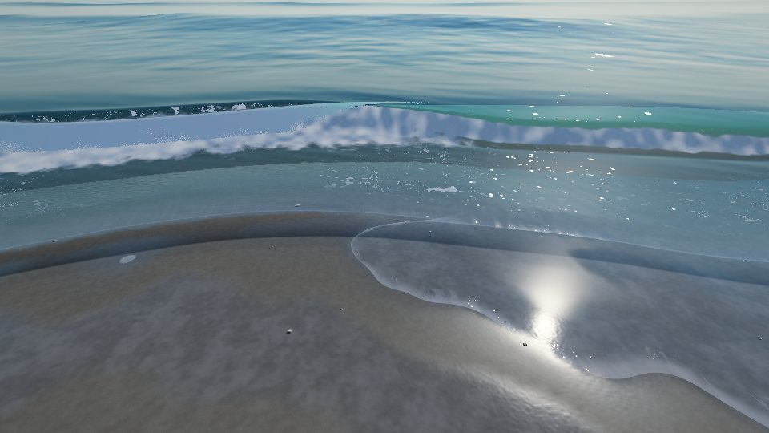

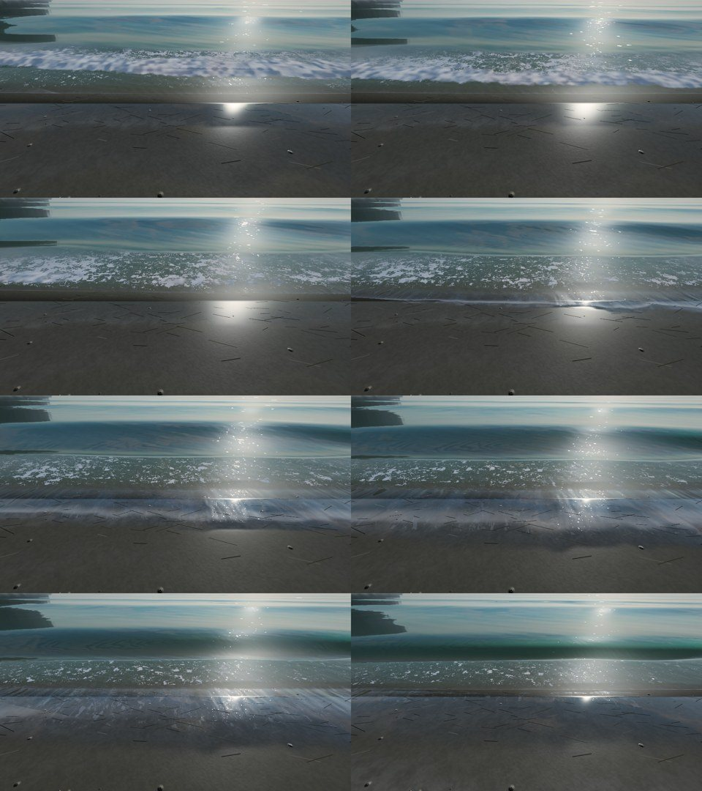

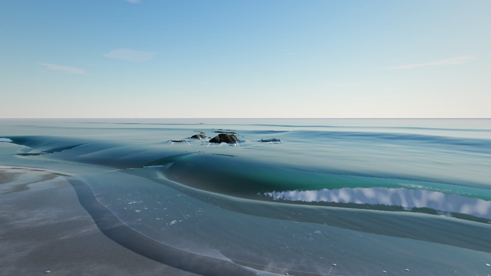

## 7. 巻き波の波頭と飛沫（SurfLip, SurfSpray）

高さの場では波頭が前へ巻き込めないので、巻き波（砕波点の ξb がおよそ 0.4 以上）の投げ出される波頭だけ、別のメッシュにした。視点のまわり 60 m の岸沿いの帯（192 × 12 の格子）で、各列の頂点が自分の列で今崩れかけている波頭を探し（沖から陸へ半波長より細かい歩幅で位相の折り返しを探す）、そこから噴流を出す。崩れの段階に応じて波高の 0.6 倍ほど前へ投げ出され、前の谷へ落ち、先へいくほど薄く白くなる。崩れていない区間では帯がつぶれて消えるので、波頭の一部ずつが巻き、斜めの波では崩れが波頭に沿って横へ走る。水より先に描くので、波の内側に入る根元は水が覆う。

飛沫は状態を持たない GPU パーティクル（中 1600、高 3200、低 600、超軽量なし）。各粒子は短い周期ごとに岸沿いのどこかで生まれ、生まれた瞬間に自分の列で崩れている波頭を探して弾道で飛ぶ（巻き波の波頭からは前上方へ、段波の前面からは低く、霧は大きく薄く風下へ）。砕波がなければその周期は隠れる。岩や護岸に印のある所では、波頭が当たった瞬間に上へ跳ね上がる。水の合成のあとに、場面の深度と手で比べて（ソフトパーティクル）描く。

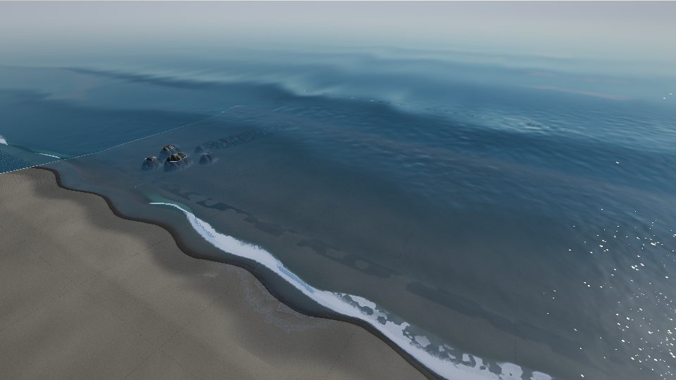

## 8. LOD と画質

| | 近く（〜35 m） | 中（〜120 m） | 遠く |
|---|---|---|---|
| 波の形 | 視線のたどり（立体） | 平面 + 波の勾配の法線 | 小さな波の法線、風浪の低いオクターブ |
| 泡 | 4 種すべて（糸・Voronoi・塊） | 被覆の平均（模様は画素で平均化） | 消える（90〜220 m） |
| 遡上・引き波・水膜 | 記憶バッファ + 解析 | 解析の帯のみ | — |
| 巻き波・飛沫 | 波頭メッシュ・GPU 飛沫 | （35〜60 m で薄れる） | — |
| きらめき | 細かいセル | 画素サイズのセル | 太陽の帯 |
| 反射 | 映り込み（中・高）/ キューブマップ | 同 | 物理的な Fresnel |

| 画質 | 立体の波 | 砂の記憶 | 巻き波 | 飛沫 |
|---|---|---|---|---|
| 高 | 16 歩 | 1024²（40 m、4 cm） | あり | 3200 |
| 中 | 12 歩 | 512²（40 m、8 cm） | あり | 1600 |
| 低 | なし（平面） | 256²（32 m、1 フレームおき） | なし | 600 |
| 超軽量 | なし | なし（帯が湿る） | なし | なし |

負荷（`node tests/smoke/surf-perf.mjs`、ソフトウェア描画 SwiftShader、走水の満潮で波打ち際が画面を占める視点、1 フレームの平均のうち寄せ波全体の割合。2 回の計測）: 超軽量 2〜6 %、低 7 %、中 13〜15 %、高 13〜22 %（2 回目はビルドと並行して測ったので揺れが大きい）。SwiftShader は CPU で描くので、実機の GPU での値ではなく画質どうしの比べとして読む。重い物理計算はせず、増える描画は記憶の更新 1 回（低以上）、巻き波 1（中・高）、飛沫 1（低以上）のみで、波・泡・遡上は水と地面のシェーダの中。

## 9. ゲームの中（走水）

- ふだんの海況: Hs 0.4 m、周期 4.2 s、南（浦賀水道、沖を見て右）から少し斜め。日ごとに 0.6〜1.6 倍（日の番号で決まる）。
- 探索の潮位（−0.3 m）: 汀線は干潟の 1:25 の上。波は汀線から 7〜10 m 沖でゆっくり崩れ（崩れ波）、白波の段波が何本も干潟を渡る。
- 満潮（+0.5 m 前後）: 汀線は 1:9 の前浜の上。波は汀線から 2〜3 m で巻き込み（巻き波）、砂の上へ強く駆け上がる。
- 沖は湾口の風浪で細かく荒れ（`chop: 1.0`）、太陽の下にきらめく。

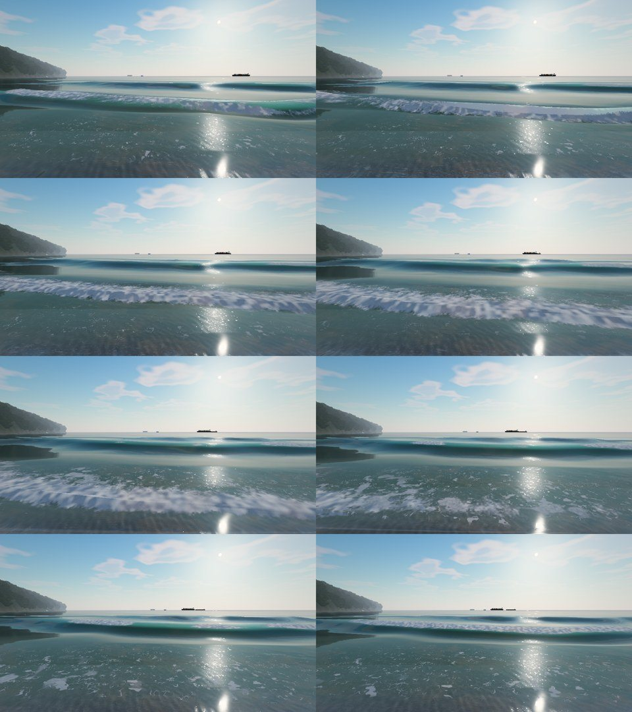

| 探索の潮位（−0.3 m）: 干潟の上で崩れる波と段波 | 満潮の浜沿い: 前浜で崩れて汀線沿いに走る白波 |
|---|---|
| 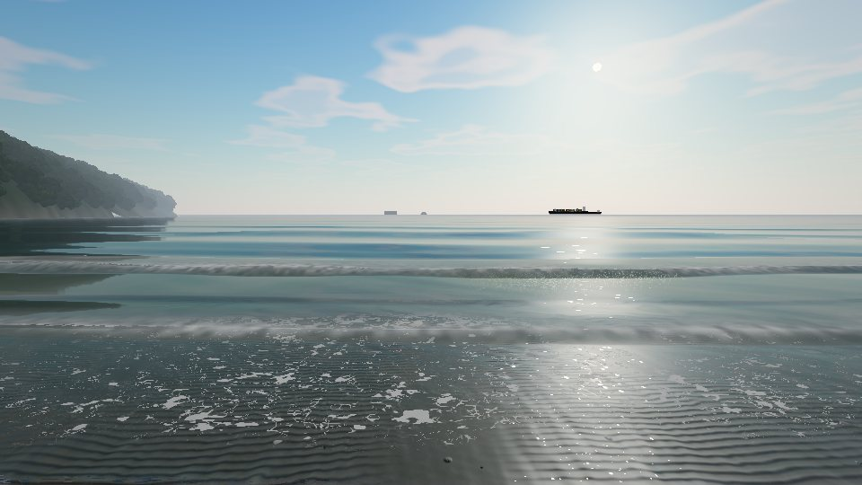 | 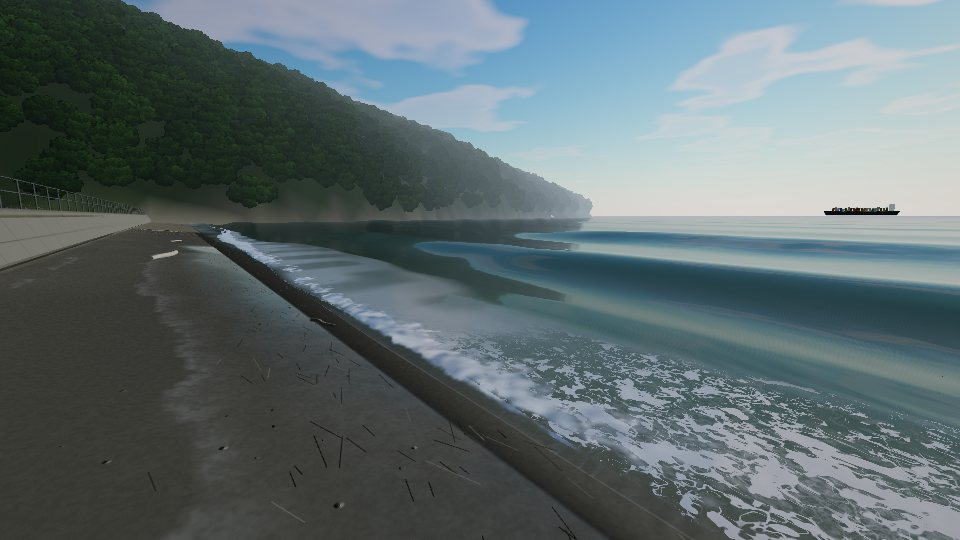 |

## 10. 確認の手順

- `npm run check`: 物理式の値（Weggel、Iribarren、Stockdon、波形の正規化）、走水とラボの浜の砕波帯の順序と潮位による移動、岩の陰・衝突面・砂州の記憶、潮位区間の作り直しの回数、画質の段階。
- `node tests/smoke/surf.mjs [--quality mid] [--only mid,high,big,feet,along,side,debug]`: 走水で浜から沖、満潮、大きめの海況、足元の遡上、浜沿い、デバッグ表示。シェーダエラーで失敗。
- `node tests/smoke/surf-lab.mjs [--views beach,feet,along,side,reef,drone] [--n 12 --dt 0.55]`: ラボの各視点の連番（波の時刻を固定するので毎回同じ画）。
- `node tests/smoke/surf-perf.mjs`: 画質ごとの負荷とコンパイル確認。
- ゲームの F3（デバッグ）: 潮位の上書きで汀線と砕波帯が動くこと、`__higata.world.water.setSurfDebug(1|2|3)` で区分・泡・位相を見る、`__higata.world.setSeaState({ height, period, angle, spread })` で海況を変える。

## 11. 調整できる値

- `ShoreLayout.surf`（`SurfParams`）: `height`（沖の端の有義波高）、`period`、`seaward`、`angle`（波向、+ は岸沿い +y 側から）、`spread`（波ごとの向きの揺らぎ）、`slope`（地形に勾配がないときの予備）。
- `ShoreLayout.water.chop`: 沖の風浪の強さ（0: 葛西・漫湖のような穏やかな水面）。
- 画質（`QUALITY_PRESETS`）: `surfSteps`、`surfMemory`、`surfLip`、`spray`。

## 12. 制限と今後

- 波頭の巻き込みは帯メッシュで、チューブの内側の光（波の中から見た空）は描かない。
- 飛沫は砕けている波頭の位置を解析的に探すので、同じ列で二つの波頭が同時に崩れていると沖側だけに出る。
- 岩の回折は「遅れて届く」「陰が浅くなる」の近似で、干渉縞（岩の裏の交差する波）は作らない。
- 走水の海況は湾口の典型値からの推定（観測値ではない）。
